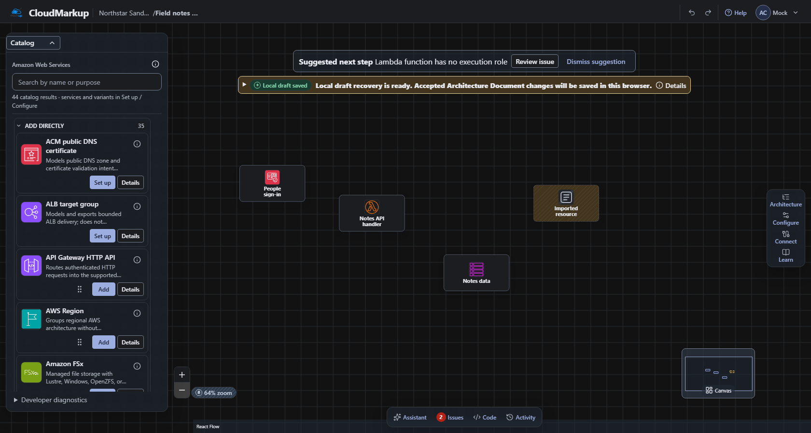

# Cloud Markup

Cloud Markup turns reviewed intent into a versioned architecture that people can
edit, validate, freeze and export. Its AWS-first canvas combines curated
services, typed connections, workload intent and deterministic
Terraform/CloudFormation generation. AI contributes proposals; deterministic
domain logic and explicit review control what becomes an approved design.

**Website:** [cloudmarkup.com](https://cloudmarkup.com/) has the product
overview and walkthroughs.
[Try the hosted beta](https://beta.cloudmarkup.com/login) to use the separately
deployed service; its available capabilities follow its deployed release. To run
this application yourself, use the
[local editor quickstart](#try-the-editor-locally) or the
[persisted standalone guide](scripts/self-host/README.md).



_Editor preview using a synthetic test fixture. The catalog, canvas and local
draft controls shown here are application UI; no customer infrastructure was
deployed._

## Try the editor locally

The public application source is
[`hunter-west/CloudMarkup-App`](https://github.com/hunter-west/CloudMarkup-App).
Install Node.js **24.18.0** and pnpm **11.16.0**. Clone the application source
and run:

```sh
git clone https://github.com/hunter-west/CloudMarkup-App.git
cd CloudMarkup-App
pnpm install --frozen-lockfile
pnpm dev
```

Open the Local URL printed by Vite, select **Log in**, then **Continue to local
shell**. On the **Field notes API** card, select **Open project overview**, then
**Open editor shell** to explore the catalog and canvas. This is a
credential-free, synthetic web preview without an AWS account, model key or
payment setup. For a persisted end-user installation, use the
[standalone operator guide](scripts/self-host/README.md): it packages the same
application with PostgreSQL 17 and real local-owner sessions. Its core profile
has explicit image, private-file, bootstrap and permission prerequisites. A
disposable PostgreSQL 17 installation has passed persisted project, restart and
restore checks; a separately configured local profile has also produced and
downloaded an infrastructure-only CloudFormation ZIP. See the
[configured runtime guide](scripts/self-host/CONFIGURED_MODELS.md) for its extra
steps. Local model-provider calls and application-code generation remain
separate, unproved capabilities.

The separate
[credentialless development guide](docs/development/LOCAL_DEVELOPMENT.md)
describes seeded contributor fixtures. Its PG17 setup candidate selects the
standalone profile through explicit bootstrap and runtime-permission stages;
fresh-database seed/API/restart acceptance remains unqualified. It is not the
persisted end-user quickstart.

This source snapshot supports local development and inspection. Hosted delivery
requires separate operator configuration and release qualification. Installing
the workspace does not activate cloud resources or paid integrations. The
checked-in AWS target and provider identifiers are non-deployable examples; see
[platform configuration](docs/development/PUBLIC_PLATFORM_CONFIGURATION.md).

## Product boundaries

- The typed Architecture Document owns topology and infrastructure meaning.
  Workload Behavior, Application Contracts and External Resource References own
  their declared intent; immutable Solution Revisions bind exact versions.
- Every edit uses the atomic, versioned Graph Command engine. Preconditions fail
  closed, inverses are explicit, and generated resources retain their lineage.
- Canvas position, zoom and Guided/Professional wording never change deployment
  meaning, authorization, validation or artifact content.
- Repository observations, model output and cloud evidence remain untrusted data
  until reviewed deterministic operations accept them. Observation is not design
  authority.
- Stable IDs and pinned tools/catalogs preserve deterministic output and IaC
  addresses. SVG/PNG exports are rendered artifacts, not browser screenshots.
- Cloud Markup exports customer infrastructure; it does not apply customer IaC,
  receive customer cloud credentials or execute arbitrary generated extensions.
  Its own platform delivery has a separate reviewed operator boundary.
- Domain behavior stays provider-neutral. AWS contracts and adapters do not
  become AWS dependencies in the core.

## Architecture and ownership

| Area                                                               | Canonical owner                                  |
| ------------------------------------------------------------------ | ------------------------------------------------ |
| React/Vite editor, projects and review UI                          | `apps/web`                                       |
| Hono API, authorization, application services and hosted workers   | `apps/api`                                       |
| Graph semantics and atomic commands                                | `packages/domain`                                |
| Runtime schemas, JSON Schema and HTTP contracts                    | `packages/schemas`, `packages/api-contract`      |
| Provider contracts, AWS catalog and deterministic rules            | `packages/provider-sdk`, `packages/provider-aws` |
| Model/commercial boundaries and synthetic evaluation               | `packages/model-gateway`, `evals`                |
| Source, diagrams, imports, exports and customer workflow artifacts | Capability packages under `packages/`            |
| Closed Terraform/CloudFormation compiler                           | `services/iac-compiler`                          |
| Platform CDK, runtime packaging and operational delivery           | `infra/platform`                                 |

The [system overview](docs/architecture/SYSTEM_OVERVIEW.md) explains dependency
direction and trust boundaries. The
[workspace guide](docs/development/WORKSPACE.md) maps packages to commands and
local environments.

## Local setup and verification

The local preview above needs Node and pnpm. Compiler and complete repository
checks additionally need pinned Go **1.26.8**. Keep the dev terminal running
while you work; press Ctrl+C there to stop it.

`pnpm dev` starts the synthetic web preview; its web predev command builds the
required workspace dependencies. The contributor API scripts need a separate
`pnpm build:backend` before bootstrap, migration, seed or API startup. They use
the standalone PG17 profile and separate bootstrap/migrator/runtime logins; full
native contributor acceptance remains pending. See
[credentialless local development](docs/development/LOCAL_DEVELOPMENT.md).
Installation does not enable cloud integrations or grant credentials.

For a persisted standalone installation using real local-owner sessions and the
shared application image, follow the
[standalone operator route](scripts/self-host/README.md). This core profile
keeps models and optional adapters disabled. The operator guide records prior
synthetic acceptance; verify the actual image, database, browser and restart
behavior for each installation before relying on it. It uses a distinct durable
storage format and explicit operator provisioning. Run the guide in this order:
inspect source hashes; prepare the pinned images and every private
configuration/password/proof file; build; start PostgreSQL; provision the
empty-database roles; apply the standalone migrations; activate the core
permissions; initialize the local owner; check runtime permissions; start the
app and its foreground transport; then verify readiness, browser sessions and
persistence. The guide gives the exact commands and acknowledgement changes for
each stage.

AI and other optional integrations remain part of the maintained application
source, but are unavailable in this standalone core profile. A provider key,
endpoint change or public repository does not admit those services. Configured
provider use additionally requires real provider/IAM access and a compatible
authorization, funding/usage, worker and storage composition with its own
qualification. No such local enablement is supplied by the quickstart.

```powershell
pnpm test:related <source-files...>
pnpm check:public
pnpm check:web
```

Choose the gate that owns your change. `pnpm check` aliases `check:public`:
builds, public quality/security checks, web/UI, public contracts, backend and
platform tests. Its database, pinned compiler and registry prerequisites still
apply. `pnpm check:full` adds coverage and Storybook. Browser profiles run
separately through the documented `test:e2e*` commands. The
[public CI workflow](.github/workflows/public-ci.yml) runs the public gate,
local/operator tooling and existing browser profiles on a standard hosted runner
with synthetic PostgreSQL and a locally built compiler. Repository
branch-admission settings remain an owner publication step. Private beta
admission and scheduled/manual coverage belong to the separately controlled
hosted repository. Read [testing guidance](docs/engineering/TESTING.md) before
treating skips or narrow checks as release evidence.

## Contributor navigation

| Question                              | Start here                                                                                                                                                                    |
| ------------------------------------- | ----------------------------------------------------------------------------------------------------------------------------------------------------------------------------- |
| How do I make and verify a change?    | [CONTRIBUTING](CONTRIBUTING.md), [WORKSPACE](docs/development/WORKSPACE.md)                                                                                                   |
| Which repository rules apply?         | [AGENTS](AGENTS.md), [execution plans](docs/engineering/EXECUTION_PLANS.md)                                                                                                   |
| What should the product do?           | [Product specification](docs/product/PRODUCT_SPEC.md), [user workflows](docs/product/USER_WORKFLOWS.md), [MVP scope](docs/product/MVP_SCOPE.md)                               |
| How do UI and accessibility work?     | [UI specification](docs/design/UI_SPEC.md), [accessibility](docs/design/ACCESSIBILITY.md), [assistance modes](docs/design/GUIDED_AND_PROFESSIONAL_MODES.md)                   |
| Who owns semantics and authority?     | [Domain model](docs/architecture/DOMAIN_MODEL.md), [authorization](docs/architecture/AUTHORIZATION_MODEL.md), [security principles](docs/architecture/SECURITY_PRINCIPLES.md) |
| Why was an architectural choice made? | [ADR index](docs/adr/README.md)                                                                                                                                               |
| How do provider changes work?         | [Provider catalog guide](docs/development/PROVIDER_CATALOG.md)                                                                                                                |
| What must pass review?                | [Code review](docs/engineering/CODE_REVIEW.md), [Definition of Done](docs/engineering/DEFINITION_OF_DONE.md), [dependency policy](docs/engineering/DEPENDENCY_POLICY.md)      |

See [optional development tooling](CONTRIBUTING.md#optional-development-tooling)
for `.agents` skills and `.codex` settings; repository safeguards still apply.

## Repository layout

The root keeps tool-discovery entry points for pnpm, TypeScript, ESLint, Vitest
and Turborepo. Browser profiles live under `config/playwright/` and run through
the documented `pnpm test:e2e*` commands. They provide regression coverage and
are not application runtime dependencies. Build output, browser reports, local
credentials and caches stay untracked under the repository ignore rules.

## Support and security

Follow [SECURITY.md](SECURITY.md) for private reporting. GitHub private
vulnerability reporting must be enabled and verified during publication; this
unpublished snapshot does not claim it is active. Do not publish vulnerability
details, credentials, customer diagrams or proprietary prompts in an issue.
Public distribution and repository visibility still require separate release
review.

## License

Cloud Markup project code is licensed under the [Apache License 2.0](LICENSE).
Third-party dependencies and bundled tools retain their own licenses and
notices. AWS service icons and AWS marks retain their separate source terms and
trademark rules; the Apache license does not grant rights to them. The
[provider-icon source record](packages/provider-aws/assets/SOURCE_REVIEW.md)
identifies the imported icon package and its approved product surfaces.
