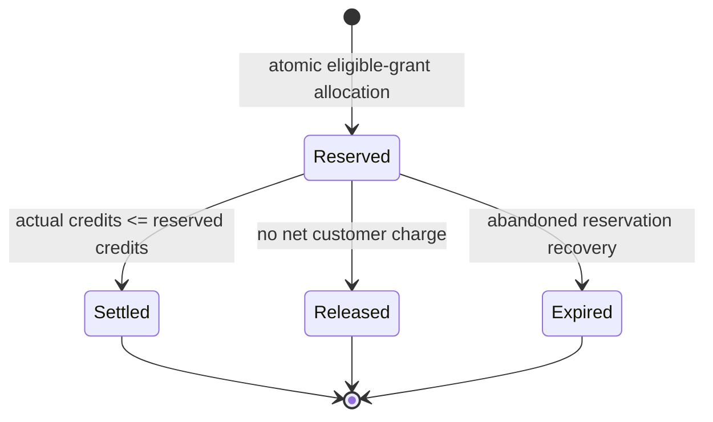

# ADR-0023: Provider-neutral commercial domain and credit accounting

- **Status:** Proposed
- **Date:** 2026-08-03
- **Owners:** Cloud Markup product and engineering
- **Supersedes:** ADR-0009 only for its organization-owner-only
  billing-management clause
- **Refines:** ADR-0010 and ADR-0022
- **Superseded by:** None

Maintainer acceptance is required before this proposal becomes an accepted
decision. The beta values below are configurable product examples, not legal or
contractual terms.

## Context

Cloud Markup needs a provider-neutral commercial core before it integrates a
payment provider or invokes a model. The core must explain plan entitlements,
seat and project limits, pooled organization credits, concurrent reservations,
actual usage, corrections, and historical pricing without treating browser
state, a mutable balance, or provider billing totals as authority.

ADR-0009 selected Stripe as the later fixed-subscription adapter and limited
billing management to organization owners. ADR-0010 selected shared organization
credits, atomic reservation, and append-only usage accounting, but left grant,
expiry, visibility, and failure policies for follow-up. ADR-0022 defined
canonical organization roles and deliberately reserved commercial permissions
for Prompts 24A-24C. ADR-0021 reserved one entitlement and usage storage lineage
that those prompts must evolve in place.

The beta offer now needs reviewable examples without encoding final pricing,
tax, refund, cancellation, trial, retention, or purchased-credit policy in
domain logic.

## Decision

### Organization and billing ownership

Every Cloud Markup account is an organization. A personal account is a
single-member organization, not a separate tenant or billing model. Each
organization owns exactly one Cloud Markup billing account and at most one
current external-provider customer/subscription projection when subscribed.
Public current-plan contract summaries keep organization state (`active` or
`suspended`), billing-account state (`active`, `suspended`, or `closed`), and
subscription projection (`not-subscribed` or a normalized provider state) as
independent lifecycle evidence. A non-active billing account cannot claim new
expensive operations are enabled.

The domain represents provider customer, subscription, product, price, event,
and period identities as opaque projection data behind provider-neutral ports.
Stripe remains the selected later adapter under ADR-0009, but Prompt 24A does
not install or call Stripe, accept webhooks, collect payment data, or grant
entitlements from browser state.

Plan definitions, plan versions, effective periods, feature entitlements,
numeric limits, pricing metadata, and subscription projections are versioned.
Historical entitlement and usage decisions retain the exact plan, entitlement,
charging, and pricing policy versions that produced them. Reservations also
retain the exact provider, model, and model-version tuple selected before
invocation.

### Configurable beta plan examples

The initial configuration contains these examples:

| Plan example | Proposed price metadata | Included members or seats                                                        | Projects | Organization credits                                               | Selected entitlements and limits                                                                      |
| ------------ | ----------------------- | -------------------------------------------------------------------------------- | -------- | ------------------------------------------------------------------ | ----------------------------------------------------------------------------------------------------- |
| Free Trial   | Zero                    | One active member                                                                | Two      | 150 one-time welcome credits; no recurring monthly grant initially | Limited code and diagram export as configured; no team collaboration                                  |
| Pro          | 39 USD monthly          | One included billable seat                                                       | 25       | 1,000 per explicit subscription period                             | Terraform, diagram, ZIP, and GitHub export; plan-version concurrency configured to one or two AI jobs |
| Team         | 149 USD monthly         | Five included billable seats and up to 20 nonbillable active viewers during beta | 100      | 4,000 per explicit subscription period                             | Organization roles, shared projects, audit history, GitHub export, and five concurrent AI jobs        |

The optional future Team additional-editor concept may be represented only as
inactive metadata: proposed 20 USD monthly and 250 additional shared credits. It
does not activate purchasing, automatic overage, or subscription behavior.

These examples are versioned configuration, not hard-coded legal promises. Final
plan names, prices, currencies, trial duration, taxes, proration, refunds,
cancellation, purchased-credit expiration, retention, regional availability,
support, and contractual terms remain separately approved product/legal policy.

### Commercial authorization policy version 2

Authorization continues to resolve the active principal, exact organization,
current membership, and canonical stored role before commercial policy.
Commercial policy version 2 adds these permission families:

- every active owner, administrator, editor, or viewer may read the
  organization's current plan, entitlement, seat-limit, credit-balance, grant
  expiration, and aggregate-usage summaries;
- active editors, canonical administrators, and owners may hold
  `commercial.expensive.use` to enter deterministic entitlement evaluation for
  new costly work; viewers may not;
- active owners and canonical administrators may hold `billing.manage` and
  `usage.read-technical`;
- editors and viewers cannot manage billing or read restricted provider-cost
  detail merely because they can run or review project work; and
- administrative credit adjustment is not an organization-membership permission.
  It belongs to a separate trusted platform-administrator or
  system-reconciliation boundary with explicit actor, reason, organization,
  idempotency, and audit context. Both cases use the protected
  `internal-administration` port with an explicit actor and actor principal. An
  automated reconciler uses a dedicated service principal at that boundary
  rather than the ordinary `internal-accounting` worker authority.

This supersedes only ADR-0009's owner-only billing-management sentence. Its
hosted-payment, webhook-authority, payment-data, local-projection, and
non-metered-token decisions remain accepted. It refines ADR-0022 without adding
a free-form role or trusting request/JWT capability claims.

Active owner, administrator, and editor memberships are billable-seat
candidates. Active viewers are nonbillable subject to the plan's viewer limit.
Pending invitations, suspended memberships, and removed memberships do not count
as active or billable seats. The deterministic domain counter receives the
effective membership snapshot. The authorized API/persistence boundary composes
the public seat summary's `asOf`, `planVersionId`, and `contractVersion`
evidence from persisted state; the counter cannot invent time or plan evidence.

### Grant-backed credit accounting

Available Cloud Markup credits are derived from credit grants and append-only
ledger events; there is no authoritative mutable balance field. Ordinary grants
have stable identity, kind, integer units, start, optional expiration,
eligibility, source, and idempotency evidence. Ordinary issuance kinds are
one-time, monthly, promotional, and purchased.

Administrative credit correction is not ordinary grant issuance. A positive
administrative allocation bucket may back a trusted positive correction. Every
positive or negative credit effect is recorded once as an append-only
`adjustment` event, and the bucket is excluded from ordinary granted-credit
totals.

Eligible grants are consumed in this deterministic order:

1. earliest expiration;
2. lowest configured consumption priority;
3. earliest grant start; and
4. stable grant ID.

Non-expiring grants sort after every eligible expiring grant. Purchased-credit
expiration is explicit versioned policy data. If that policy has not been
approved, a purchased grant cannot be activated by inventing an expiration or
silently assuming that it never expires.

Consumption priority is versioned grant metadata, with lower integer values
consumed first. It is not a customer price, provider cost, or mutable balance.

Monthly grants use an explicit subscription-period identity as their idempotency
boundary and expire at that period's end. Reprocessing the same period cannot
issue a second grant.

Within an organization, one-time issuance identity is the pair of
`sourcePlanVersionId` and `grantPolicyVersion`. Expiration kind,
expiration-policy version, and expiration timestamp govern eligibility but are
not issuance identity, so an expiration-only change cannot reissue credits. A
new, reviewed `grantPolicyVersion` may authorize another one-time issuance. A
non-null `sourceReference` remains an additional same-kind replay boundary and
must also be unique.

### Reservation and plan-change rules

A reservation atomically captures the organization, acting principal, project,
feature, request/job identity, plan version, entitlement-policy version,
charging-policy version, pricing version, provider, model, model version,
estimate, and exact allocations from eligible grants. A later plan, policy,
pricing, or provider-default change affects new reservations only. An active
reservation survives the change and settles against its captured versions,
provider/model tuple, and grant allocations.

Reserved allocations that expire while work is active may still settle. A
release after expiration does not revive those units as available credit.
Settlement may charge fewer credits than reserved but cannot exceed the
reservation under `cloudmarkup-charging-and-failure-v1`. A request that would
require an upward settlement must enter an explicit non-charge state and
reconciliation path rather than create a negative balance or silent overage.

Each reservation reaches exactly one terminal state: settled, released, or
expired. Duplicate requests, callbacks, retries, and deliveries reuse stable
idempotency identities and cannot reserve or charge twice. Corrections and
customer credits use new compensating ledger events with trusted actor and
reason; they never rewrite the settled usage or erase provider-usage and cost
evidence.

Canonical technical usage-event kinds are `grant`, `reservation`, `settlement`,
`release`, `expiration`, `provider-failure`, and `adjustment`. Every event
retains its `chargingPolicyVersion`.

The nullable `chargingScenario` is the versioned policy classification. The
non-null `outcome` is the technical ledger result for each emitted event. The
fields are distinct and cannot substitute for one another; lifecycle events may
have no scenario, and some policy scenarios intentionally emit no event.

Other fields are sparse by kind: absent project, job, model, provider, or
reservation evidence is not replaced with fabricated values. Each correction
retains stable reason, recorder, exact allocation effects, and immutable
related-event or reservation correlation.

### Failure and compensation policy

The `cloudmarkup-charging-and-failure-v1` policy classifies outcomes
deterministically. Every emitted usage event retains that exact policy version
as audit context so later revisions cannot reinterpret historical credit
effects:

| `chargingScenario`                      | Canonical technical outcome or event treatment                         | Customer-credit effect                                     |
| --------------------------------------- | ---------------------------------------------------------------------- | ---------------------------------------------------------- |
| `request-rejected-before-invocation`    | No usage event                                                         | No reservation and no charge                               |
| `insufficient-credits`                  | No usage event                                                         | No invocation and no charge                                |
| `user-cancelled-before-invocation`      | `canceled`                                                             | Release and no charge                                      |
| `provider-failure-before-useful-output` | `provider-failure`                                                     | Release to no net charge                                   |
| `cloudmarkup-internal-failure`          | `internal-failure`                                                     | Release to no net charge                                   |
| `proposal-delivered-user-rejected`      | `useful-output-delivered`                                              | Settle actual normalized usage                             |
| `user-requested-redesign`               | No outcome on the prior event; a distinct reservation emits `reserved` | Start a new metered operation                              |
| `automatic-retry`                       | No new event; replay preserves the original event and outcome          | Reuse the idempotency identity and never double-charge     |
| `system-required-repair`                | `useful-output-delivered`; a separate correction is `compensated`      | Stay within the accepted reservation or compensate credits |

The lifecycle technical outcomes `granted`, `reserved`, `released`, `expired`,
`compensated`, and `adjusted` are not charging scenarios. `no-useful-output`
remains valid technical vocabulary but has no direct current version 1 scenario
mapping.

Provider usage remains available for reconciliation even when the customer
credit effect is compensated. Normalized provider usage and estimated cost
remain separate from customer credits; a provider or internal failure may
preserve provider evidence while the net customer charge is zero. Cost totals
remain grouped by currency and are never combined across currencies.

### Limits, extensions, suspension, and kill switch

Entitlement decisions return stable denial reasons that distinguish membership,
feature, organization limit, member/project limit, credit, suspension,
concurrency, and platform kill-switch failures.

Per-member and per-project extensions require explicit versioned authorization,
scope, effective period, actor, reason, and audit evidence. They cannot silently
bypass the selected plan or alter historical decisions.

A commercial suspension or expensive-operation kill switch blocks new costly
operations. Credit exhaustion alone has the same bounded effect. These states do
not remove manual editing, reading existing projects, access to already
generated artifacts, or permitted data export. Separate security, authorization,
retention, or deletion policy may still restrict access for its own documented
reason.

An inactive subscription projection remains factual provider-neutral evidence.
Because cancellation and other subscription-change access policy is unapproved,
the evaluator raises `Subscription-state access policy is unavailable.` before
returning any entitlement decision. This is fail-closed policy absence, not an
approved rule that permits or denies any class of post-change access.

## Consequences

### Positive

- One provider-neutral model serves personal and team organizations.
- Historical plan, grant, pricing, seat, and usage decisions remain explainable.
- Deterministic allocation and atomic reservation prevent concurrent double
  spend without a mutable balance authority.
- Compensation can restore customer credits without destroying provider-cost
  evidence.
- Commercial denial can degrade expensive assistance while preserving manual
  product access.

### Negative

- Grant allocation, reservation expiry, plan changes, and compensation require
  transactional state and recovery procedures.
- Commercial authorization policy version 2 requires additive contract,
  migration, and role-matrix evidence.
- Provider reconciliation can legitimately differ from customer-credit totals.
- Purchased grants cannot be offered until their expiration policy is approved.

## Non-goals

This decision does not:

- integrate Stripe, accept a webhook, charge a payment method, or collect card
  details;
- call Bedrock or another model provider;
- implement pay-per-token invoicing, automatic overage, or unlimited AI;
- define tax, refund, cancellation, trial-duration, retention, or contractual
  policy;
- put commercial state in the Architecture Document or let browser state select
  entitlements; or
- authorize platform IaC, customer IaC deployment, cloud credentials, or
  deployment.

## Follow-up

- Maintainers must accept or revise this proposal before treating it as a
  durable repository decision.
- Prompt 24A may add versioned schemas, deterministic domain behavior, internal
  ports, additive persistence, and tests only.
- Prompt 24B owns Stripe-hosted flows and signed webhook projection updates.
- Prompt 24C owns exposed authorized billing, entitlement, and usage interfaces.
- Purchased-credit expiration, production commercial/legal terms, retention,
  provider pricing, and reconciliation operations require later approval.

## Alternatives considered

### Keep a mutable organization balance

Rejected because it cannot explain grant expiration, concurrency, retries,
pricing changes, or compensation.

### Re-evaluate active reservations after every plan change

Rejected because it makes an accepted operation depend on later subscription
events and can make settlement nondeterministic.

### Make organization administrators ordinary credit-adjustment operators

Rejected because customer-facing billing administration and privileged ledger
correction are different trust boundaries.

### Implement beta examples as fixed legal terms

Rejected because configuration examples cannot establish tax, refund,
cancellation, retention, or contractual policy.

## References

- [Commercial Model](../product/COMMERCIAL_MODEL.md)
- [Billing and Usage](../architecture/BILLING_AND_USAGE.md)
- [Authorization Model](../architecture/AUTHORIZATION_MODEL.md)
- [Security Principles](../architecture/SECURITY_PRINCIPLES.md)
- [Testing Strategy](../architecture/TESTING_STRATEGY.md)
- [ADR-0009](0009-stripe-subscription-boundary.md)
- [ADR-0010](0010-ai-credits-usage-ledger.md)
- [ADR-0021](0021-postgresql-data-api-and-object-storage.md)
- [ADR-0022](0022-verified-principal-and-canonical-organization-authorization.md)
