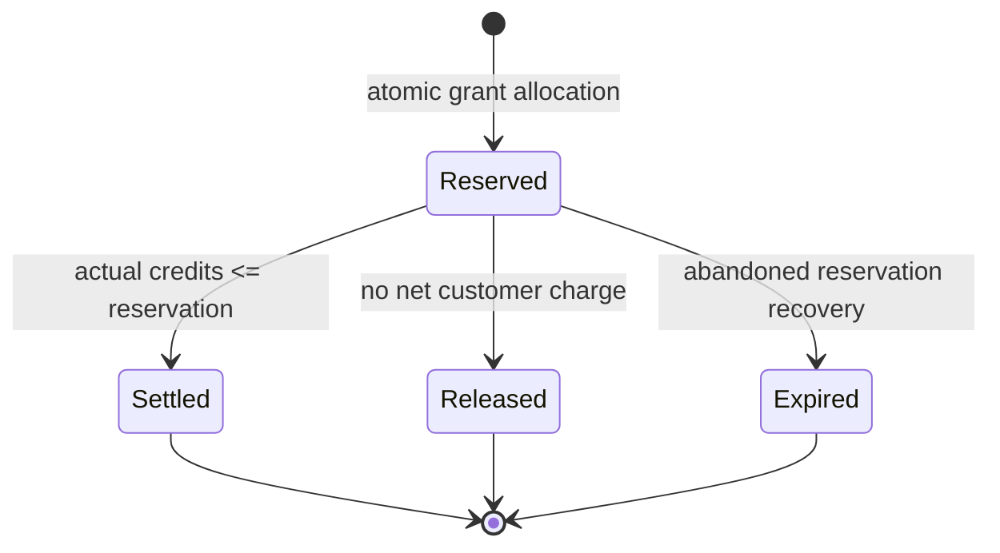
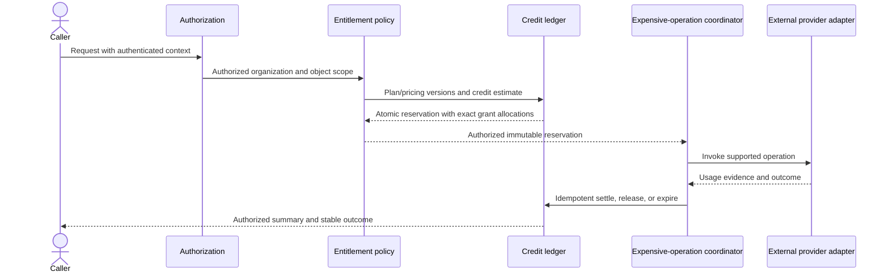

# Billing and Usage

> Public distribution note: links to internal historical plans and operational
> records are omitted here; the retained text describes the original decision or
> design.

## Independent staff trial preparation

The [proposed trial boundary](../adr/proposed-staff-trials.md) extends
[ADR-0081](../adr/0081-live-billing-and-platform-staff.md) with an independent
trial record and promotional grant. The effective entitlement projection may
select an immutable copy of current Professional features/limits with its own
identity and one-time bounded grant; no trial command writes a subscription
projection or included paid allowance. Trial and paid grant allocations stay
separate. Canonical staff/session checks, account locks, ETags and idempotency
protect atomic grant/revoke plus immutable audit. Database-clock admission and a
fresh locked dispatch check plus current export/sharing authority enforce expiry
and revocation without a cleanup dependency. Already dispatched usage can
settle; release cannot restore eligibility to revoked/expired credits. Paid
conversion supersedes trial admission and cancellation cannot revive it. See the
plan for local verification and activation holds.

## Purpose and ownership

This document is the canonical architecture record for provider-neutral
subscription projection, entitlement evaluation, accounting for Cloud Markup
credits, and provider-usage reconciliation. The customer-facing beta examples
are defined in [Commercial Model](../product/COMMERCIAL_MODEL.md).

Each user has a private personal workspace and may explicitly join or create
organizations. Each workspace has its own billing account; the existing
organization-scoped storage identity is retained for compatibility. Plan, seat,
entitlement, grant, reservation, usage and projection data stay isolated to that
workspace. They are not part of the Architecture Document and cannot affect
deployment semantics.

Architecture, Workload, External Resource, Application Contract, Repository
Snapshot, Observed Solution, Reconciliation Proposal, Solution Revision,
source-ownership, generation-coverage, AI-extension, Active Issue, and Evidence
records are solution semantics or provenance. They grant no entitlement, reserve
no credits, and append no commercial usage event. See
[Solution, Repository, and Continuous-Evidence Contracts](SOLUTION_REPOSITORY_AND_EVIDENCE.md).

A future model operation, including AI-assisted generation or repair, must first
pass commercial authorization and entitlement policy, then atomically reserve
organization credits before provider invocation. Its Solution Revision/model/
prompt provenance and validation Evidence remain separate from provider usage
and customer-credit ledger facts.

## September 30 allowance successor

The approved Pro successor is `planver_pro_2026_09_30_v5`, selected by
`cloudmarkup-starter-pro-credit-mapping-2026-09-30-v4`. It keeps the $39 monthly
USD price, existing features and ten-member limit, and includes 1,250 credits
per eligible paid period. Migration `0081` appends the plan and admits its exact
identity to the existing invitation validation trigger. Prior plan rows,
subscriptions, invoices, grants and ledger entries are unchanged.

A fresh verified provider observation selects the successor only for periods
starting on or after September 30, 2026 UTC. An already-issued grant is never
replaced. Older paid periods retain their 1,000-credit allowance; eligible
renewals receive 1,250 once and expire at that subscription period's end.
Starter-to-Pro supplements use the selected period's allowance (1,050 for a new
200-credit Starter period), retain the original paid grant, and do not reset
consumption. A newer worker derives credits from the selected immutable plan,
not from its newest configuration defaults.

The immutable purchased-credit policy defines $5/100, $15/350 and $30/800 USD
packs with no expiration. Local one-time purchase persistence, verified
paid-session fulfillment and gated Checkout are implemented under proposed
[ADR 0067](../adr/0067-one-time-credit-purchases.md). The default-off creation
gate does not disable fulfillment of existing paid attempts. Refund/dispute
observations retain grants and consumed history for manual reconciliation;
operational refund/dispute policy remains open. Current hosted activation and
real-payment acceptance evidence belong to [STATUS](../PUBLIC_STATUS.md). See
the
[account and repository requirements](../product/POST_BETA_ACCOUNT_AND_REPOSITORY_REQUIREMENTS.md).

## Public credit summary cursors

The production balance and funding-overview adapters preserve valid public
`usage_*` cursors. The optional cursor is omitted when the latest immutable
entry uses an exact existing internal writer format: beta-AI settlement/release,
test-to-live cutover, staff grant/revocation, paid top-up, canonical
reservation, or model terminal settlement/release. Unknown or malformed stored
identities still fail closed. This projection does not rename ledger entries,
change amounts, confer authorization or widen the public cursor schema. The
repair record owns verification and deployment status.

## Live provider and staff authority

Accepted [ADR 0081](../adr/0081-live-billing-and-platform-staff.md) adds
explicit test/live provenance and canonical platform permissions outside
customer organization roles. Staff grants require an active plan and use the
same append-only ledger, reservation and allocation machinery. Amount, expiry,
target confirmation, current authorization, recent authentication and immutable
audit are mandatory. Staff may grant to their own active-plan account. Staff
cannot fabricate a subscription or grant a temporary tier.

An operator-only, digest-bound cutover preserves test history, archives its
projections and compensates remaining non-staff test credits. Live authority
requires the immutable cutover receipt; database guards reject later test
projection/event writes. These controls are delivered; current activation and
acceptance evidence remain in [STATUS](../PUBLIC_STATUS.md). See the activation
runbook.

## Credit overview

The additive v1 credit-overview read returns the unchanged v1 balance nested
with available monthly, purchased and other credit amounts and the next actual
expiration. One canonical ledger SQL statement supplies all amounts at the same
database instant, including signed adjustments, settlements and active
reservations. Its buckets reconcile exactly to available credits. Scheduled,
expired and unresolved grants cannot increase an available bucket. The next
expiration combines currently available amounts at the earliest grant deadline;
it excludes fully consumed or reserved grants. No history limit or current plan
allowance is used to estimate a balance.

The Usage page reads this scoped snapshot, rechecks response identity and clears
it on authorization loss. It distinguishes spendable funding from lifetime
recorded totals. The original credit-balance route keeps its strict response
shape for existing clients. No database migration or financial mutation policy
is introduced by the overview.

## September 30 AI conversion successor

Owner-approved migration `0082` adds `pricing_beta_sonnet46_global_20260930_v2`:
400 credits per USD4 of model cost (1/10,000 credits per provider-cost
microdollar), with whole-credit rounding. The provider token rates remain
unchanged. The migration uses the supported one-way close of the preceding
pricing window at its transaction boundary and starts the successor at the same
boundary, preventing overlapping price windows. It preserves historical pricing
fields, charges and reservations. Runtime replay, record, settlement and release
use the reservation's recorded pricing policy. The new runtime and migration are
a coupled local change; neither is live. Retail packs and Pro subscription
allowances are independent of this conversion.

## Separated concerns

| Concern                           | Authority                                                                                | Purpose                                                                   |
| --------------------------------- | ---------------------------------------------------------------------------------------- | ------------------------------------------------------------------------- |
| Payment and external subscription | Signed external-provider events plus the trusted local projection when an adapter exists | Determine external subscription lifecycle                                 |
| Product entitlements              | Versioned local plan, commercial authorization, and entitlement policy                   | Authorize capabilities and organization/member/project limits             |
| Cloud Markup credits              | Eligible grants plus append-only ledger events                                           | Authorize and account for expensive operations                            |
| Raw provider usage                | Per-request provider/model usage record                                                  | Explain usage, estimate cost, and support reconciliation                  |
| Aggregate provider billing        | AWS or other provider billing data                                                       | Reconcile totals after the fact, never authorize an immediate request     |
| Solution provenance               | Immutable Solution Revision, AI-extension, issue, and Evidence records                   | Explain what was proposed or verified; never authorize or account credits |

Subscription billing, entitlements, customer credits, and raw provider usage
must not be collapsed into one mutable counter or treated as direct Stripe usage
metering. Browser state is not an authority for any concern.

## Billing account and subscription projection

An organization billing account has stable local identity and owns the current
plan selection, commercial state, and at most one current external-provider
customer/subscription projection. Provider customer, subscription, product,
price, event, and period identities remain opaque data behind provider-neutral
ports.

The public current-plan derived contract view exposes three independent
lifecycle layers: organization state (`active` or `suspended`), billing-account
state (`active`, `suspended`, or `closed`), and subscription projection
(`not-subscribed` or a normalized provider state). No layer aliases another. In
particular, a non-active billing account cannot claim that new expensive
operations are enabled, regardless of organization or subscription state.

A projection records provider kind, ordering or last-accepted-event evidence,
normalized state, plan-version mapping, effective times, subscription-period
identity and bounds, and safe audit correlation. Stripe remains the selected
later adapter under ADR-0009, but the provider-neutral domain does not import a
Stripe SDK or require a live provider request to evaluate an entitlement.

The Prompt 24B external-event flow is:

1. An owner or canonical administrator with recent authentication asks the
   application service for Checkout or Portal.
2. The server resolves the verified organization and billing account, selects
   one configured Starter/Pro Price, and asks either the fake or Stripe sandbox
   adapter for a hosted URL.
3. The provider handles payment details. Browser return state remains
   non-authoritative.
4. POST /webhooks/stripe reads exact bytes and passes them to the configured
   adapter. Stripe sandbox verification checks the endpoint-specific HMAC and
   60-900 second timestamp tolerance before decoding JSON.
5. The provider adapter allow-lists the bounded event type and normalizes one
   fixed-quantity, monthly, no-trial subscription snapshot.
6. Persistence records provider event ID, payload digest, ordering position,
   attempt, and safe lifecycle evidence without the raw body or signature.
7. Application logic validates exact Product/Price mapping plus local
   organization, billing-account, customer, and subscription ownership.
8. The Prompt 24A command/persistence boundary updates the subscription and
   entitlement projections. invoice.paid may append one period-scoped monthly
   grant; no other event invents credits.
9. Duplicate processing returns the stored outcome, a retry resumes incomplete
   work, and historical-event adapters ignore older projection events. The
   current Stripe refresh boundary below instead reconciles authenticated
   current state under a captured database version; event IDs are not causal
   subscription ordering.

The deterministic fake is authoritative for ordinary local development and CI.
The Stripe adapter accepts sandbox API keys only and all tests use injected
fetches or reviewed fixtures. Prompt 24B makes no live call, creates no
infrastructure, and exposes no browser-facing Checkout/Portal API; Prompt 24C
owns those authenticated interfaces. Runtime authorization reads the trusted
local projection and never performs a live billing-provider lookup.

Prompt 47A adds controlled-beta configuration and operational evidence without
enabling live mode. Test/live identities and secret references are separated;
the current/optional previous webhook secret overlap is bounded; the synth-only
platform has raw-body ingress, encrypted FIFO delivery/DLQ, and safe alarms. The
production queue resource composition, production support host, scheduled
reconciliation host, and aggregate provider-cost ingestion remain explicit
activation work. See
[Controlled-beta billing readiness](../development/BILLING_READINESS.md).

### M9 durable sandbox delivery candidate

Ingress and the consumer now share the exact version-1 delivery contract. Only
after raw-byte signature verification can ingress queue the allow-listed event
identity, original payload digest, API/version pins and object reference; it
does not queue payment bodies or signatures. Valid unsupported event types are
acknowledged without delivery. The consumer validates the entire bounded batch
and exact environment/account/Region FIFO source before accessing a secret or
processing any message. FIFO failure returns the failed and unprocessed suffix.

The worker retrieves the exact event through authenticated Stripe test-mode API
access, rechecks its identity/version/reference against the signed ingress
envelope, and retains the original wire digest as receipt evidence. The
queue-only provider mode cannot verify arbitrary browser webhook bodies or
create Checkout/Portal sessions. API responses are bounded and timed out;
redirects are rejected. The production worker factory uses the real Data API
database and existing PostgreSQL billing/commercial stores, with exact resource
and API-key secret references. It is not yet composed into a deployed Lambda
event-source mapping, queue policy or runtime role.

Stripe resolves ownership first, captures the current projection version, then
performs a final authenticated subscription read and rechecks exact
organization, account, customer and subscription identity. Current state is not
discarded because a historical event ID sorts lower: canonical changes use the
captured version's compare-and-swap; an unchanged snapshot also rechecks the
version after the provider wait. A conflict leaves the receipt retryable and
forces a new observation. No SQL lock spans the provider wait. Observation time
is used for refreshed state, while the original signed event identity remains
receipt evidence. Cancellation is terminal for one subscription ID; only a
genuinely new, exactly owned subscription can replace it.

Paid invoice grants require the exact currently active subscription period,
latest invoice, subscription item, fixed quantity, Product/Price mapping and
payment evidence. An old invoice cannot grant credits for a newer unpaid period.
A verified current-period paid invoice may still grant its one period allocation
when a newer subscription projection was processed first, without replacing that
projection. Durable receipt and grant idempotency cover retries, duplicates and
distinct events for the same period. Real PostgreSQL worker tests are prepared
separately from HTTP/SQL adapter unit tests; a skipped local database suite is
not activation evidence.

Public Checkout/Portal composition, trusted initial billing-account
provisioning, the configured sandbox Portal and webhook endpoint, runtime
queue/IAM resources, and authenticated end-to-end provider evidence remain
required. The worker factory alone does not activate sandbox billing or
authorize live charging.

## Versioned plans, entitlements, and denial reasons

A plan definition has stable identity and one or more effective plan versions. A
version carries provisional price metadata, feature entitlements, numeric
limits, included-seat rules, viewer limits, organization-credit policy, and
expensive-operation concurrency. The active beta configuration contains only
Starter at 9 USD/200 monthly credits and Pro at 39 USD/1,000 monthly credits. It
has no recurring free plan, trial, automatic overage, annual price, credit pack,
or Team/seat-billing behavior. These remain reviewable configuration rather than
legal terms.

The versioned policy can configure projects; exact `active-owners`,
`active-administrators`, and `active-editors` role limits; active members;
billable seats; grant-based credits; ZIP, diagram, GitHub, Terraform, and
available CloudFormation export; complete supported application generation;
validation jobs; plan/deployment evidence workflows; concurrent expensive jobs;
per-user request counts; per-project credit caps; and feature flags. A disabled
or unavailable capability remains explicit rather than implied by plan name.

The versioned numeric-limit period vocabulary is exactly `none`,
`subscription-period`, `calendar-month`, and `rolling-day`. The selected value
is explicit plan data and is retained in evaluated-limit evidence; it is never
inferred from a plan name, feature, scope, or current date. A member/project
extension to a configured plan limit must match that limit's period and cannot
silently substitute another period.

An entitlement decision retains organization, plan version, subscription
projection version, commercial-policy version, evaluation time, operation kind,
feature or limit key, organization/member/project scope, requested target role
where applicable, every evaluated limit, decision, stable denial reason, and
safe evidence. Stable denial families distinguish at least:

- membership or commercial permission;
- disabled feature;
- organization, member, or project limit;
- billable-seat or viewer limit;
- insufficient or unavailable credits;
- concurrent-operation limit;
- organization suspension;
- inactive verified subscription outside policy-approved grace; and
- expensive-operation kill switch or platform failure.

Membership and object authorization run before entitlement evaluation. A caller
cannot select another tenant with an organization, billing, subscription,
project, grant, reservation, or usage identifier.

Per-member and per-project extensions require explicit versioned authorization,
scope, effective period, trusted actor, reason, and audit evidence. A scoped
extension cannot lower a configured plan limit, silently change its configured
period, or otherwise bypass or mutate the selected plan.

## Commercial authorization policy version 2

Commercial policy version 2 extends the canonical roles without trusting request
fields, JWT claims, or free-form capability arrays:

| Commercial permission                                                                               | Viewer | Editor | Administrator | Owner |
| --------------------------------------------------------------------------------------------------- | ------ | ------ | ------------- | ----- |
| Read current plan, entitlement, seat-limit, credit, grant-expiration, and aggregate-usage summaries | Yes    | Yes    | Yes           | Yes   |
| Start a new authorized expensive commercial operation                                               | No     | Yes    | Yes           | Yes   |
| Manage billing and external subscription workflow                                                   | No     | No     | Yes           | Yes   |
| Read restricted technical usage and provider-cost detail                                            | No     | No     | Yes           | Yes   |
| Perform administrative credit adjustment                                                            | No     | No     | No            | No    |

The canonical permission names are `commercial.summary.read`,
`commercial.expensive.use`, `billing.manage`, and `usage.read-technical`,
respectively. These permissions do not replace feature, limit, credit,
suspension, or kill-switch evaluation.

Administrative credit adjustment belongs to a separate trusted
platform-administrator or system-reconciliation boundary. It requires explicit
actor/system identity, authorized organization scope, reason, idempotency key,
correlation, and immutable audit evidence. An ordinary organization owner or
administrator cannot mint, remove, or rewrite credits.

Both human support and automated reconciliation enter through the protected
`internal-administration` application port with an explicit actor identifier and
actor-principal identifier. The ordinary `internal-accounting` worker authority
cannot issue an administrative adjustment; an automated reconciler therefore
uses its own dedicated service principal at that administration boundary.

Active owner, administrator, and editor memberships are billable-seat
candidates. Active viewers are nonbillable subject to the configured viewer
limit. Pending invitations, suspended memberships, and removed memberships do
not count as active or billable seats. The deterministic domain counter receives
the effective membership snapshot only. The authorized API/persistence boundary
composes the public seat summary's `asOf`, `planVersionId`, and
`contractVersion` from persisted context; the counter does not invent a
timestamp, plan version, or contract evidence.

## Credit grants and derived availability

Cloud Markup credits are integer customer-facing usage units, not currency or
raw provider tokens. Monetary estimates use integer micros plus an explicit
currency; binary floating point is never authoritative for money.

Credit availability is derived from grants, reservations, and append-only ledger
events. It is never one authoritative mutable balance column. An ordinary grant
records:

- stable grant and organization identity;
- one-time, monthly, promotional, or purchased issuance kind;
- positive integer units;
- start and optional expiration;
- eligibility and source policy version;
- subscription period where applicable;
- activation state; and
- idempotency and audit evidence.

Eligible grants are allocated deterministically by:

1. earliest expiration;
2. lowest configured consumption priority;
3. earliest grant start; and
4. stable grant ID.

Non-expiring grants sort after every eligible expiring grant. Purchased-credit
expiration is explicit versioned policy data. If product/legal policy has not
approved it, a purchased grant cannot become active by inventing an expiration
or silently assuming no expiration.

Consumption priority is versioned grant metadata; lower integer values are
consumed first. It is a deterministic allocation input, not a customer price,
provider cost, or mutable balance.

Monthly included grants use one explicit organization/subscription/period
identity as their idempotency boundary and expire at that period's end.
Reprocessing the same event or another paid event for that period cannot issue a
second grant. Prompt 24B has no welcome or recurring free grant.

The beta paid-period upgrade policy
`cloudmarkup-paid-period-upgrade-allowance-v1` appends an expiring promotional
grant for the difference between the configured Professional allowance and the
original Starter monthly grant. The worker must freshly read an authenticated
active Professional subscription, match its exact subscription/period/dates to
the durable monthly paid-invoice grant, and verify the original monthly grant
policy and Starter allowance. Identity includes organization, subscription,
period and upgrade policy; the existing same-kind source-reference uniqueness
also prevents reissuance. The supplement pins its original paid source plan, so
later plan-mapping adoption cannot rewrite its replay payload. The original
monthly grant and usage ledger remain immutable. Historical-only providers,
missing payment evidence and inactive periods cannot issue this allowance. No
migration or new public contract is required.

The canvas reads the authenticated credit summary, scoped to principal and
organization capabilities. It shows available credits and outstanding
reservations, links to Usage, refreshes on focus and at most once per minute
while visible, and hides stale balances after errors or permission changes.
Graph edits do not themselves poll or spend credits.

Concretely, one-time issuance identity is organization scope plus
`sourcePlanVersionId` and `grantPolicyVersion`. Expiration kind,
expiration-policy version, and expiration timestamp determine eligibility but
are not part of that identity, so changing expiration alone cannot issue the
credits again. A new, reviewed `grantPolicyVersion` may authorize a new one-time
issuance. A non-null `sourceReference` is an additional same-kind replay
boundary and must also be unique.

Administrative credit correction is separate from ordinary grant issuance. A
positive administrative allocation bucket may provide immutable allocation
evidence, but the signed credit effect is recorded once as an append-only
`adjustment` event with trusted actor/system, reason, idempotency, and related
event or reservation evidence. The bucket is not counted again in ordinary
granted-credit totals.

## Reservation allocation and plan changes

Before a new expensive operation, application logic:

1. resolves current principal, organization membership, object ownership, and
   commercial permission;
2. evaluates feature, organization/member/project, suspension, kill-switch, and
   concurrency limits;
3. calculates an explainable integer credit estimate under a versioned pricing
   policy; and
4. atomically reserves exact units from eligible organization grants.

The reservation captures organization, acting principal, project, feature,
request and job identity, plan version, entitlement-policy version,
`chargingPolicyVersion`, pricing version, provider, model, model version,
estimate, and exact per-grant allocations. A later plan, policy, pricing, or
provider-default change affects new reservations only. An active reservation
survives and settles against its captured versions, provider/model tuple, and
allocations.

Reserved allocations that expire while work is active remain eligible for that
reservation's settlement. Releasing them after grant expiration does not revive
them as available credit. The `cloudmarkup-charging-and-failure-v1` policy
permits settlement below or equal to the reservation only; it cannot settle
above the reserved units. An upward adjustment enters an explicit
no-additional-charge reconciliation state rather than a negative balance or
silent overage.

A reservation reaches exactly one terminal state:

Reservation, invocation, retry, settlement, and message delivery use stable
request/job/idempotency identities so duplicate work cannot reserve or charge
twice.

The normative expensive-operation sequence is:

This diagram defines expensive-operation contracts and ordering. Prompt 24B
implements billing-provider calls only; it does not broaden model invocation.

## Asynchronous job commercial hooks

Async job creation exposes injected entitlement and optional reservation
decision ports. Before queue publication, one durable creation claim wins for
the verified organization and actor, names the operation and exact request
digest, and stores the correlation and preallocated job identities. Only that
claim may evaluate the hooks. Its complete safe normalized outcomes and opaque
references are durable and immutable. An unfinished duplicate returns
`in-progress` without rerunning hooks; completed and denied duplicates return
their original outcome. The trusted ownership-scoped stale-claim reconciler also
never calls either hook. It completes only from already durable approvals and an
immutable creation plan; missing decisions, expiry, or invalid parent/dependency
authority fail closed. Opaque references remain available for external
commercial reconciliation. Expensive work may be denied before a job is queued.
A denial has no job row; claim denial and a separate claim-linked audit entry
are stored atomically. Job events remain foreign-keyed to existing jobs.

The async framework does not define plans, balances, grants, pricing, model
costs, charging scenarios, Stripe state, settlement, release, expiration, or
usage-ledger authority. Commercial implementations remain responsible for their
own idempotency and for every terminal reservation transition. Job retry,
cancellation, supersession, expiry, and success are coordination evidence only;
they cannot directly move credits. The billing/usage-reconciliation family has
only a deterministic fake handler in Prompt 25 and performs no reconciliation.

## Append-only usage and compensation

Usage events are immutable and organization-scoped. Corrections use new events;
settled rows are never overwritten. Events record where applicable:

- usage event, request, job, reservation, organization, acting principal,
  project, feature, and idempotency identity;
- provider, model, model version, pricing-policy version, and the captured
  charging-policy version;
- input, output, and cache token counts when reported;
- latency, nullable `chargingScenario`, non-null technical outcome, and
  customer-credit effect;
- integer estimated provider cost micros and currency;
- credits reserved, settled, released, expired, or compensated;
- exact grant-allocation effects;
- trusted adjustment reason and actor/system identity; and
- timestamps and safe correlation/audit references.

The canonical technical event kinds are `grant`, `reservation`, `settlement`,
`release`, `expiration`, `provider-failure`, and `adjustment`. Every event
retains `chargingPolicyVersion` as immutable audit context.

`chargingScenario` is a nullable versioned-policy classification, while
`outcome` is the non-null technical ledger result for an emitted event. Neither
field substitutes for the other. Lifecycle events with no charging scenario and
policy cases that intentionally emit no event therefore remain explicit rather
than receiving a fabricated classification or outcome.

Other fields are sparse by kind. For example, a grant does not fabricate project
or model data, an expiration need not contain provider metrics, and an
adjustment identifies its exact allocation effects plus a related usage event or
reservation. Stable event, idempotency, recorder, reason, reservation,
allocation, and related-event identities form immutable correlation evidence.

Usage records contain no raw prompts, model responses, credentials, card data,
or unrestricted architecture content by default.

### ModelGateway normalized usage boundary

Prompt 34 adds a strict technical invocation descriptor and normalized usage
record before Prompt 34A commercial integration. Raw request authority is
validated first and bound as `authorityInputDigest`. Schema-preserving redaction
then rebinds affected hashes and metadata; the sanitized request is parsed and
authority-validated again before its separate `inputDigest` is computed. The
invocation claim binds the raw authority through `authorityDigest` and the
sanitized provider input through `inputDigest`.

The descriptor binds organization, user, project, Solution Revision, repository
snapshot, job, feature, provider, model/version, inference profile,
prompt/version/digest, invocation and idempotency identity, sanitized input
digest, requested mode, complexity,
route/effort/capability/configuration/pricing provenance, and zero execution
tool authority. Usage records input, output, cache-read, cache-write, and
thinking units; provider request identity; attempt number; timestamps/duration;
and the technical result. Its deterministic `usageRecordId` is the durable
idempotency identity for one exact `(invocationId, attemptNumber)` tuple, so
successful, failed, canceled, and invalid-output provider attempts can be
recorded without duplication.

The gateway fails closed when provider usage is missing or the injected recorder
fails. The recorder is not the ledger: it cannot decide entitlement, reserve
credits, allocate grants, settle, release, expire, compensate, price, or
reconcile. No parallel model-usage counter is permitted.

Prompt 34R adds `modelRouteEstimateInputV1Schema`. It carries only route-aware
technical units, attempt/effort bounds, escalation possibility, operating
buffer, and exact model/pricing configuration references. It does not compute a
customer charge, reserve credits, or settle usage. Deep requires a Pro
entitlement and accepted estimate confirmation. One eligible internal escalation
records zero incremental customer-credit units beyond that accepted maximum;
Cloud Markup absorbs the provider increment. Its one-time invocation claim binds
the exact original invocation and routing-decision digest, accepted maximum,
credit decision, feature, scope, and sanitized input lineage.

Prompt 34A now supplies the provider-neutral estimate, confirmation, quota,
atomic-reservation, historical-pricing, settlement, release, compensation,
retry, expiration, and reconciliation lifecycle around a supplied callback.
Immutable model-usage detail must reference the existing organization-scoped
Prompt 24A ledger; no live provider or Stripe call is composed. See
[Model commercial lifecycle](MODEL_COMMERCIAL_LIFECYCLE.md).

Default ModelGateway logs contain safe metadata and hashes only, never raw
prompt, response, source, diagnostic, secret, or unrestricted solution content.

A compensating credit adjustment changes the customer-credit effect with a new
append-only event. It does not erase provider usage, estimated provider cost, or
historical pricing evidence. Reconciliation compares provider totals to the
immutable technical usage stream and the separately derived customer-credit
stream. Normalized provider usage and per-currency estimated cost remain
distinct from customer-charge credits. Provider or internal failure may
therefore retain nonzero provider evidence while producing zero net customer
charge. Repair and customer compensation remain append-only, and aggregate cost
views never sum different currencies into one amount.

## Failure and charging policy

`cloudmarkup-charging-and-failure-v1` is the canonical classification version
for the beta behavior below. Every emitted usage event retains that exact
version as audit context so later policy revisions do not reinterpret historical
customer-credit effects.

| `chargingScenario`                      | Canonical technical outcome or event treatment                         | Reservation and customer-credit result                | Provider evidence                     |
| --------------------------------------- | ---------------------------------------------------------------------- | ----------------------------------------------------- | ------------------------------------- |
| `request-rejected-before-invocation`    | No usage event                                                         | No reservation and no charge                          | None expected                         |
| `insufficient-credits`                  | No usage event                                                         | No invocation and no charge                           | None expected                         |
| `user-cancelled-before-invocation`      | `canceled`                                                             | Release and no charge                                 | None expected                         |
| `provider-failure-before-useful-output` | `provider-failure`                                                     | Release to no net charge                              | Preserve reported usage and cost      |
| `cloudmarkup-internal-failure`          | `internal-failure`                                                     | Release to no net charge                              | Preserve reported usage and cost      |
| `proposal-delivered-user-rejected`      | `useful-output-delivered`                                              | Settle actual usage within the reservation            | Preserve                              |
| `user-requested-redesign`               | No outcome on the prior event; a distinct reservation emits `reserved` | Start a new metered request and reservation           | Preserve per request                  |
| `automatic-retry`                       | No new event; replay preserves the original event and outcome          | Reuse the idempotency identity; never double-charge   | Retain reconciliation evidence        |
| `system-required-repair`                | `useful-output-delivered`; a separate correction is `compensated`      | Keep settlement bounded by the estimate or compensate | Preserve original and repair evidence |

The remaining ordinary lifecycle vocabulary includes `granted`, `reserved`,
`released`, `expired`, `compensated`, and `adjusted`. These are technical
outcomes, not charging scenarios. `no-useful-output` remains a valid technical
outcome but no current version 1 charging scenario maps directly to it.

No customer compensation may delete provider-cost history. A classification
version and stable outcome reason make the policy testable; subjective UI state
cannot change charging.

## Commercial suspension and expensive-operation kill switch

Organization commercial suspension, credit exhaustion, and the
expensive-operation kill switch block new costly operations. They do not by
themselves remove manual editing, reading existing projects, access to already
generated artifacts, or permitted data export. Separate security, authorization,
retention, or deletion controls may restrict access for their own documented
reason. Verified backend subscription state and the canonical ledger remain
authoritative; browser state and caches cannot grant access. Under the reviewed
controlled-beta policy, an inactive subscription never deletes projects and
preserves policy-approved existing-project access, manual editing, and approved
data export. New paid AI operations remain denied when entitlement or credits
are unavailable. Configured grace can preserve only reviewed non-expensive
operations and cannot enable paid AI or imply a future capability. See
[Controlled-beta billing readiness](../development/BILLING_READINESS.md).

## Contract and interface boundary

Prompt 24A continues to own the provider-neutral commercial domain, plan and
entitlement projections, append-only grants/ledger, reservation accounting, and
authorized persistence. Prompt 24B adds only:

- provider-neutral hosted Checkout, Portal, webhook-verification, and
  subscription-snapshot application ports;
- a deterministic fake adapter for local development and CI;
- an optional dependency-free Stripe sandbox adapter with a pinned reviewed API
  contract;
- internal Checkout/Portal application operations guarded by billing.manage,
  recent authentication, and current database membership;
- the dedicated exact-raw-body POST /webhooks/stripe route;
- tenant-safe event digest/retry/order/outcome persistence and safe audit
  evidence; and
- verified-state orchestration into the existing Prompt 24A subscription,
  entitlement, and monthly-grant boundaries.

Prompt 26 owns only the bounded typed organization plan/credit summary route and
UI backed by fake/local billing. It does not expose Checkout, Portal, billing
management, technical usage, or a live provider. Prompt 24C still owns the
broader public authenticated organization billing, Checkout, Portal,
entitlement, seat, credit, grant, usage-summary, technical-detail, and protected
administrative contracts/UI. Prompt 27 owns infrastructure. The Prompt 24B
Stripe code cannot deploy, accept live keys, expose a card surface, or turn a
browser redirect into entitlement.

Balance, grant-expiration, seat, and usage summaries remain derived views.
Technical usage detail is more restricted than organization summaries.
Assistance may vary wording, contextual education, recommendations, and optional
technical disclosure only; Guided and Professional use the same component
structure, controls, dimensions, fields, commercial sources, authorization,
validation, generation, and evidence. Mode never changes permission or
entitlement. Aggregate member-visible usage omits provider-cost totals.

## Security and privacy

### M9 sandbox hosted-session composition

The restoration candidate adds `billing.workspace.get`,
`billing.checkout.create` and `billing.portal.create` to the versioned public
API. This is a bounded part of the formerly deferred Prompt 24C surface, not
seat administration, raw usage detail, live billing or full billing activation.
The server reads current tenant/account/subscription metadata and returns a
compact plan catalog. Missing subscriptions are `not-subscribed` with a null
plan, never an inferred paid entitlement. Disabled hosted-session configuration
keeps the catalog visible and every purchase/manage action unavailable.

The production host verifies current principal, organization, membership and
canonical role rows under short SQL locks. Management also requires recent
authentication. No database transaction spans a secret or Stripe request. Exact
account/customer/lifecycle and actor authority are rechecked after secret I/O,
immediately before HTTP, and before releasing a hosted URL. POST routes require
the exact application origin and strict versioned inputs; browser fields cannot
set prices, customer IDs, account IDs or return destinations. Authorized account
bootstrap is idempotent and does not create a subscription, entitlement, trial,
grant or ledger entry. Audits contain safe metadata, not hosted URLs or bodies.

Migration `0021` persists an immutable request digest and stable provider
idempotency identity, with one unresolved Checkout attempt per billing account.
Retries use the same provider identity within a database-clock 23-hour creation
window. An unknown provider effect cannot be discarded, rekeyed or assumed
expired after that window. Known sessions can be retrieved without creating a
second session. Only verified terminal state, exact ownership and disabled
provider recovery links permit retiring an old attempt; completed sessions also
require exact locally canceled subscription evidence. Different browser keys or
plan selections cannot bypass the open-attempt fence. An authorized returning
browser may retry an unknown attempt with identical server-owned parameters
within the original 23-hour window, using the same durable provider idempotency
identity. No hosted URL is stored.

The browser handles one confirmed conflict through the ordinary plan button: it
refreshes current subscription state before retrying once with a new request
key. Only server-verified terminal provider evidence can replace the account
attempt. An uncertain network/provider response retains the existing key. After
Checkout return, at most twelve read-only status refreshes run over one minute;
return navigation never grants a plan.

Hosted-session-only secret resolution reads the one reviewed full ARN lazily,
accepts only an unambiguous test key, and cannot verify or process webhook
events. The separate signed-ingress/queued-provider-processing path remains the
only subscription and included-credit authority. Return URLs are derived from
the verified organization and are navigation only. Exact Stripe HTTPS hosts are
validated at provider, public-contract and browser boundaries. The compact UI
fences late results after tenant/session/membership changes or departure.

The real Usage page reads canonical ledger balances through current tenant
authorization and exact response binding. Zero is returned only after an
authorized query proves no billing account exists; GET never provisions an
account, subscription, trial or grant. Invalid, denied and cross-tenant results
cannot become zero. The page separates subscription status from available and
reserved credits and does not invent historical usage.

The restricted sandbox Portal configuration is now created and verified. Webhook
configuration, resource/IAM composition, real PostgreSQL CI and deployed
lifecycle acceptance remain required before enabling sessions. The new HTTP
contracts alone do not make a purchase-to-AI workflow operational.

- Provider webhook secrets, API keys, database credentials, and model
  credentials live only in approved secret-management and deployment channels.
- The webhook boundary enforces exact-byte signature verification, timestamp
  tolerance, replay identity, event allow-listing, bounded payloads, and safe
  outcomes. Edge/origin rate controls and the operational verification required
  before beta are tracked in the Controlled-beta Threat Model, the
  [AWS Platform Deployment Boundary](AWS_PLATFORM_DEPLOYMENT.md), and the
  Controlled-beta Residual-risk Report.
- Tenant identity comes only from verified authentication and current
  server-side ownership/membership data.
- Billing, entitlement, grant, reservation, credit, and raw usage detail are
  tenant-authorized; technical detail has a narrower permission than summaries.
- Solution records cannot supply subscription, entitlement, reservation, grant,
  charging, pricing, or usage authority. Provider/model metadata in solution
  provenance is untrusted correlation until matched to the authorized commercial
  operation.
- Administrative adjustments use a separate trusted boundary and immutable audit
  event, never a caller-supplied tenant or actor.
- Logs and metrics use identifiers, counts, outcomes, and bounded errors rather
  than payment, prompt, response, or customer architecture bodies.
- Retention and deletion preserve required accounting/audit evidence while
  honoring approved privacy and legal policy. Current implementation behavior,
  export exclusions, and unresolved business/legal periods are recorded in the
  [Data Classification, Retention, and Deletion Policy](DATA_CLASSIFICATION_RETENTION_AND_DELETION.md).

## Required evidence

Prompt 24A evidence includes:

- every beta plan example and version/effective-date behavior;
- welcome, monthly, promotional, and purchased-policy grant contracts plus the
  distinct trusted administrative-adjustment contract;
- monthly-period and welcome-grant idempotency;
- earliest-expiration/priority/start/stable-ID allocation and non-expiring-last
  behavior;
- atomic concurrent reservation, insufficient credit, partial settlement,
  release, expiry, and duplicate retry;
- active reservation across plan/policy/provider-default change and grant
  expiration, with exact plan, entitlement, charging, pricing, provider, model,
  and model-version pins;
- no settlement above reservation;
- append-only compensation with retained provider-usage reconciliation;
- zero-net-customer-charge failures that preserve normalized provider usage and
  per-currency estimated cost without cross-currency aggregation;
- canonical sparse technical kinds and immutable related-event correlation;
- active seat counting by role and pending/suspended/removed exclusion;
- commercial policy version 2 across all canonical roles;
- organization-shared pools, member/project extensions, suspension, kill switch,
  and manual-access preservation;
- cross-tenant summary and technical-detail denial, plus permission-constrained
  reservation and trusted-adjustment boundaries;
- integer credit and monetary-micros invariants;
- redaction and absence of prompts, responses, credentials, and payment data;
- exact `cloudmarkup-charging-and-failure-v1` classification evidence; and
- negative contract tests proving that freezing a Solution Revision, recording
  an AI extension, changing generation coverage, opening/closing an Active
  Issue, or publishing any Evidence level cannot reserve, settle, release,
  expire, compensate, or adjust credits without the separately authorized
  commercial operation.

Prompt 24B evidence covers authorized Starter/Pro Checkout, arbitrary plan
rejection, Checkout idempotency, Portal authorization, valid/invalid/stale
signatures, exact raw bytes, duplicate and reordered events, retry after a
database failure, payment failure/recovery, cancellation state, unknown mapping,
deleted organization, cross-tenant ownership, monthly grant deduplication,
200/1,000-credit grants, both plan-switch directions without proration, sandbox
enforcement, and payment/secret redaction. The Postgres suite covers migration,
tenant lookup, event retry/completion, safe audit evidence, and cancellation
projection when a dedicated test database is supplied.

Prompt 24C adds exposed-interface contract, authorization, and presentation
evidence. Prompt 27 supplies the platform boundary, and Prompt 47A adds the
controlled-beta lifecycle, reconciliation, support, rotation, and alarm evidence
summarized in
[Controlled-beta billing readiness](../development/BILLING_READINESS.md). Prompt
48 must reverify those controls and the remaining live-mode, human-policy,
notification, and operational blockers before beta. None of this evidence
authorizes deployment or live charges.

See [ADR-0009](../adr/0009-stripe-subscription-boundary.md),
[ADR-0010](../adr/0010-ai-credits-usage-ledger.md), and proposed
[ADR-0023](../adr/0023-provider-neutral-commercial-domain-and-credit-accounting.md).

## Prompt 35 Bedrock metering

Bedrock Converse and ConverseStream usage is normalized to input, output,
cache-read, and cache-write units plus provider request identity. The current
Bedrock TokenUsage contract does not expose separate reasoning units, so the
adapter records `thinkingUnits=0` rather than estimating them; output and total
provider usage remain intact. A later reviewed provider-specific field may add a
separate unit without rewriting history.

Every live Intent or clarification call is wrapped by Prompt 34A before the SDK
request. Routes reference an effective immutable provider-pricing version; code
and UI do not state current prices. Pricing-unavailable disables live
settlement. The safe result exposes estimate range, Standard/Deep explanation,
reservation state, completed credits, compensation/reconciliation status, and
optional technical units. It excludes provider-cost micros, operating buffer,
conversion configuration, margin, raw content, and protected reasoning. Credits
remain a versioned internal normalization policy, not a permanent dollar/token
promise.

### Hosted beta Data API compatibility

Billing SQL binds version comparisons and timestamps explicitly because the Data
API transports strings as typed text. Known subscription, entitlement and grant
timestamps are normalized through the strict database UTC parser before replay
or period comparisons. Opaque provider references are never normalized as dates.
Loopback billing integration tests emulate Data API parameter types and JSON
timestamp/integer representations, covering hosted session recovery, verified
expiration, both monthly plans, duplicate/reordered events and denied ownership.

### Fresh-workspace staff support

Workspace creation still does not create billing, funding or subscription state.
Authorized staff directory/detail reads at /v1/staff/workspaces can discover an
unprovisioned workspace. Its explicit version-2 preview has zero funds, no
subscription/trial, operations disabled and an ETag bound to the workspace
version. Reads never initialize billing. Existing /v1/staff/accounts reads keep
their version-1 wire contracts, typed client shapes and missing-account
behavior.

Only the existing credits.grant or trials.grant authority can initialize the
empty billing account as part of the reviewed first action. Its stable identity
matches lazy Checkout. Initialization, credit/trial funding and immutable staff
receipt share one transaction; audit failure rolls them all back. Actor-bound
idempotency, same-origin transport, recent authentication, exact target
confirmation and optimistic preconditions remain required. A competing
initialization invalidates the preview rather than issuing a second grant.
Operations-management or read-only staff cannot initialize accounts, and no
subscription is created. No migration or new staff/IAM permission is introduced.
See [the staff-credit decision](../adr/0092-staff-credit-ai-access.md).

### Hosted billing return

The browser opens Checkout and Portal in a separate window during the user's
click, before awaiting the session request. The window clears its opener and
accepts only the reviewed HTTPS Stripe hosts. Its tab-scoped marker contains a
random navigation identifier and creation time, never a credential or tenant. On
return, a same-origin channel tells the originating tab to refresh its
authenticated billing state and closes the billing window. That signal cannot
establish payment, subscription, entitlement or authentication. The original tab
retains its in-memory session; closing or reloading it still requires sign-in. A
blocked window produces a retryable explanation before any billing request.
