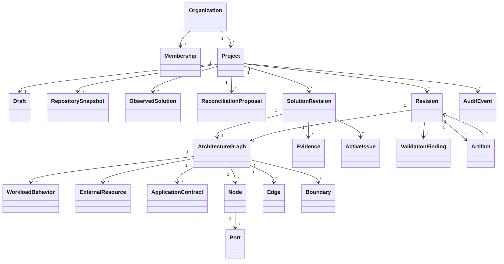

# Domain Model

## Purpose

The domain model is the semantic center of Cloud Markup. It defines what an
architecture means independently of React, storage, AWS SDKs, model providers,
and IaC syntax.

This document is normative at the conceptual level. Architecture Document v3 is
the current atomic envelope; Architecture v1/v2 and Workload Behavior v1 remain
immutable readable contracts through deterministic migration. Exact schemas live
in `@cloudmarkup/schemas` and deterministic validation, migration,
normalization, and hashing live in `@cloudmarkup/domain`. Cross-layer ownership
is summarized in
[Solution, Repository, and Continuous-Evidence Contracts](SOLUTION_REPOSITORY_AND_EVIDENCE.md).

## Aggregate overview

The diagram shows ownership and references, not storage layout.

## Identity and tenancy

### Organization

The tenant boundary for projects and membership. Organization identity comes
from trusted server-side membership resolution.

### Membership

Associates a verified actor with one canonical organization role: owner,
administrator, editor, or viewer. Permissions are derived from the current
stored role under authorization policy v1, never from request or JWT claims or
free-form persisted capability arrays. Exact role and object-access rules are
defined in [Authorization Model](AUTHORIZATION_MODEL.md).

### Project

The lifecycle owner for one evolving architecture. A project contains:

- reviewed Intent, Architecture, Workload, External Resource, and Application
  Contract sources;
- one current draft lineage;
- immutable legacy revisions and Solution Revision manifests;
- Repository Snapshots, Observed Solutions, and Reconciliation Proposals;
- validation findings and cross-source Active Issue history;
- generated artifacts and explicit source ownership;
- independently leveled Evidence;
- exports; and
- audit events.

A project is always organization-owned. Moving it between tenants is not an
implicit update and would require a separately designed privileged workflow.
Project lifecycle is explicit: active projects may be edited, archived projects
remain readable and renameable, and deletion requests enter a tombstoned
`deletion-pending` state before any later retention worker may mark them
deleted. Organization and environment data deletion use the same explicit
status/timestamp pattern; API deletion requests never physically erase rows or
objects synchronously.

## Commercial and usage aggregates

Every account is an organization. A personal account is a single-member
organization, and each organization owns exactly one Cloud Markup billing
account. The commercial domain contains provider-neutral, versioned aggregates
for:

- plan definitions, plan versions, effective periods, features, and limits;
- organization billing accounts and external subscription projections;
- entitlement decisions, commercial suspensions, and expensive-operation kill
  switches;
- seat quantities, included-seat evidence, and active role-based counts;
- credit grants and exact reservation allocations;
- append-only usage and compensating adjustment events; and
- provider pricing versions and derived usage summaries.

These aggregates are organization-owned platform data. They are not embedded in
the Architecture Document, do not change architecture semantics, and cannot
affect stable graph or IaC identity. External provider identifiers are opaque
projection data behind provider-neutral ports.

Entitlements are versioned decisions over the trusted local organization,
current membership, selected plan version, subscription projection, scoped
extensions, and commercial controls. Authorization runs before entitlement
evaluation. Browser state and caller-supplied tenant, billing, subscription,
grant, reservation, or usage identifiers never establish authority.

Credit availability is derived from active grants and append-only events rather
than one mutable balance. Grants have stable identity, integer units, kind,
start, optional expiration, eligibility, policy version, and idempotency
evidence. Eligible grants allocate by earliest expiration, then earliest start,
then stable grant ID; non-expiring grants are last. Purchased grants require an
explicit approved expiration policy before activation.

A reservation atomically captures its plan, entitlement-policy, pricing, and
exact grant allocations before expensive work. It survives later plan changes.
Reserved allocations may settle after grant expiration, while release does not
revive expired availability. Version-1 settlement cannot exceed the reservation.
Each reservation settles, releases, or expires exactly once. Corrections create
compensating events with trusted actor and reason without rewriting usage or
removing provider-cost history.

Monthly grants are idempotent for an explicit subscription period and expire at
period end. Active owners, administrators, and editors are billable-seat
candidates; active viewers are nonbillable subject to configured limits.
Pending, suspended, and removed memberships do not count. Per-member and
per-project extensions require explicit versioned authorization and cannot
silently bypass a plan.

Credit exhaustion, commercial suspension, and the expensive-operation kill
switch block new costly operations only. They do not by themselves remove manual
editing, project reads, existing artifacts, or permitted data export. See
[Billing and Usage](BILLING_AND_USAGE.md) and proposed
[ADR-0023](../adr/0023-provider-neutral-commercial-domain-and-credit-accounting.md).

## Intent model

The intent model is provider-neutral and reviewable. It distinguishes:

- **requirements** — capabilities the user says the system needs;
- **assumptions** — statements treated as true but not confirmed;
- **unresolved questions** — missing information that could affect the design;
- **nonfunctional constraints** — quality or operating constraints;
- **data sensitivity** — classifications or handling expectations;
- **availability needs** — resilience and recovery expectations; and
- **cost preferences** — priorities or constraints, not fabricated price
  guarantees.

Intent informs proposals and validation but is not a substitute for graph
configuration. Each item needs a stable identity so later proposals and
decisions can refer to it.

### Intent Document version 1

The Intent Document is the provider-neutral source of reviewed user need before
service selection. Version `1` is a strict JSON object whose Zod schema is
canonical at runtime and whose deterministic Draft 2020-12 JSON Schema supports
cross-language consumers.

It records:

- document, intent, and revision identity;
- application summary and capability requirements;
- ingress, egress, authentication, authorization, data, workflow, quality,
  environment, operational-overhead, cost, and compliance requirements;
- assumptions and unresolved questions classified as blocking or non-blocking;
- explicit user decisions and candidate alternatives with rationale metadata;
  and
- schema and provider-neutral prompt-reference provenance without raw prompts,
  responses, model-provider identity, or secrets.

Capabilities use the version-1 provider-neutral taxonomy, including values such
as `http-api`, `object-storage`, `event-queue`, and `key-value-data`. Provider
service IDs are invalid in these fields. A requirement is known, `not-required`
where the field permits that state, or explicitly `unknown`. Every unknown value
references an unresolved-question ID; deterministic code never fills one with a
hidden default.

Normalization sorts semantically unordered collections, capability references,
geographies, metrics, percentile targets, and rationale considerations. It does
not deduplicate, resolve, or repair input. Structural Zod validation remains
separate from semantic domain validation. The semantic stage rejects
contradictions detectable without AI, including:

- duplicate stable IDs and duplicate capability types;
- missing capability or unresolved-question references;
- retention ranges whose maximum is below their minimum;
- duplicate or non-monotonic latency percentile targets;
- duplicate scale metrics or peak request rates below steady rates;
- multiple active decisions for one subject;
- active decisions that leave the same subject unresolved;
- missing, mismatched, or inconsistently selected alternatives; and
- prompt-assisted source metadata without prompt provenance, or prompt
  provenance on a non-prompt source.

Ambiguity is not a validation failure when it is represented through explicit
unknown states and valid questions. Semantically conflicting documents fail
before provider planning.

### Intent IR and Architecture Document boundary

| Concern               | Intent Document / Intent IR                                  | Architecture Document                                                |
| --------------------- | ------------------------------------------------------------ | -------------------------------------------------------------------- |
| Meaning               | Reviewed provider-neutral need                               | Provider-specific deployable architecture                            |
| Service vocabulary    | Capabilities such as `http-api` and `event-queue`            | Versioned provider catalog service and resource types                |
| Unknowns              | First-class and linked to blocking/non-blocking questions    | Unresolved requirements remain explicit; compiler input fails shut   |
| Lifecycle authority   | Input to planning, alternatives, explanation, and validation | Source of truth for one immutable Cloud Markup architecture revision |
| Planning relationship | Accepted as validated planner input                          | Changed only by validated, accepted graph operations                 |
| Compilation           | Never compiled                                               | Immutable version-bound revisions are the only compiler input        |

A provider planner accepts validated Intent IR plus an explicit provider and
catalog target. The M1 interface is deliberately generic over a future
deployment-graph proposal and has no implementation or model call. Any future
proposal is untrusted proposal data; it cannot mutate an Architecture Document
until its versioned operations pass deterministic domain and provider
validation.

## Architecture graph

An `ArchitectureGraph` is a typed, versioned semantic model with presentation
metadata. At minimum it contains:

- graph identity and schema version;
- provider and provider-catalog version;
- nodes;
- typed ports;
- typed edges;
- boundaries and explicit membership or association data;
- configuration values;
- layout metadata;
- intent traceability where available; and
- provenance for system-generated elements.

### Architecture Document version 1

The Architecture Document is the provider-specific source of truth for one Cloud
Markup revision. Version `1` is a strict JSON object validated by the canonical
Zod schema and exported as deterministic Draft 2020-12 JSON Schema for
cross-language consumers.

The document binds:

- document, architecture, and immutable revision identity;
- graph-schema version `1`, provider and region, catalog
  identity/version/digest, and compiler input compatibility;
- canonical JSON media type, UTF-8 encoding, and `cloudmarkup.canonical-json.v1`
  serialization metadata;
- nodes, edges, variables, outputs, assumptions, and unresolved requirements;
  and
- deterministic provenance metadata without customer credentials or secret
  values.

`cloudmarkup.canonical-json.v1` recursively orders object property names by
UTF-16 code-unit order, preserves ordering inside values where order can carry
catalog meaning, emits two-space-indented JSON, omits absent optional object
properties, and ends with one line feed. The Architecture Document serializer
first sorts document collections by stable ID and generated-provenance
references by referenced ID because those orders have no semantic meaning.
Parsed numeric values must be finite.

Every node separates an immutable `id` and stable semantic `deploymentKey` from
its mutable `presentation.label` and `presentation.position`. The semantic
projection omits presentation and sorts element collections by stable ID; moving
or relabeling a node therefore cannot change deployment inputs.

In the bounded M1 editor, a root or non-visually-nested node stores its position
in canvas coordinates. A child whose semantic parent resolves through the exact
catalog to an allowed `boundary` stores its position relative to that parent.
The semantic `parent` remains authoritative; coordinate proximity never creates
containment. Reparenting converts coordinates to preserve visual location,
validates catalog placement, maximum depth, lifecycle, cycles, and bounds, then
applies position and parent changes atomically.

Node and edge configuration is not an arbitrary JSON escape hatch. Each
configuration record names a dot-namespaced catalog schema ID and semantic
version, and each value uses a closed discriminated type such as string,
integer, boolean, list, node reference, variable reference, or secret reference.
Provider Catalog contract version `1` validates allowed record keys and bounded
JSON Schema value kinds for an exact configuration schema/version. It also
validates the document's tagged values against literal, node-reference,
secret-reference, or sensitive-variable source metadata and applies catalog
defaults deterministically. Current AWS support is bounded by the exact catalog
and its separately evidenced compiler targets; see the
[provider guide](../development/PROVIDER_CATALOG.md). A secret reference may
identify an external secret-management concept; the document must never contain
the underlying secret.

Architecture Document v1 remains an immutable readable contract. Its validated
registry entry is now the source of the deterministic v1-to-v2 migration
described below. Unsupported future versions, malformed envelopes, unknown
document types, and unknown registry versions remain distinct diagnostic
outcomes.

Structural Zod validation and semantic domain validation are deliberately
separate. After parsing, the semantic stage rejects:

- duplicate node, edge, variable, output, assumption, or unresolved-requirement
  IDs;
- duplicate stable node deployment keys and duplicate variable/output keys;
- missing, self-referential, or cyclic parent nodes;
- edges whose source or target node does not exist;
- configuration, output, or generated-provenance references to missing elements;
  and
- variable defaults whose typed value does not match the declared variable type.

Port availability, relationship compatibility, parent semantics, and allowed
configuration keys remain provider-catalog responsibilities and are not invented
by the core v1 shape.

### Architecture Document version 2 and Workload Behavior version 1

Architecture Document v2 preserves the v1 infrastructure graph and adds one
required independently versioned `workloadBehavior` collection. Its
`contractVersion` is `1`; changing the workload contract later requires an
explicit document migration rather than silent reinterpretation.

Each Workload Behavior v1 record has a stable workload ID, exactly one owning
architecture-node ID, and a closed declarative description of implementation
intent:

- one implementation mode: infrastructure-only, user-provided,
  generated-starter, or external-artifact, with explicit source ownership;
- runtime family and handler or entrypoint intent where the mode requires them;
- stable operations with named input and output contract references;
- trigger bindings and downstream-action bindings to exact graph edge IDs and
  operation IDs;
- environment bindings and secret references that never contain secret values;
- bounded error behavior and behavior-specific timeout/retry assumptions;
- an explicit single-handler, user-provided-dispatcher, or reviewed
  generated-dispatcher policy; and
- references to unresolved implementation requirements.

The contract is not a source repository, programming language, or code AST. Its
strict schema rejects raw source, credentials, secret values, access tokens, raw
prompts, arbitrary shell commands, package-manager scripts, executable
callbacks, and undeclared extension fields.

Workload identity is independent of node display labels. Trigger and action
bindings reference stable edge IDs, so renaming or moving a node cannot recreate
workloads, change bindings, or alter IaC addresses. Removing a node or edge that
is still referenced by workload behavior fails final semantic validation; a
future workload-edit command must update those references explicitly in the same
atomic batch.

Several workload operations may use the same downstream edge because one
accepted infrastructure relationship can support several declared behaviors.
Each exact downstream edge/operation pair is unique. A trigger edge remains
bound once per workload so dispatch cannot ambiguously route one trigger edge to
several target operations without a later explicit contract change.

Semantic validation additionally requires unique workload, operation, trigger,
action, and environment-binding identities; one workload per owner; existing
owner nodes and edges; trigger edges targeting the owner; action edges sourcing
from the owner; resolved operation and in-document requirement references; and
mode-consistent implementation and dispatch fields. Input/output contract
references are closed, versioned, digest-bound external identities; this slice
does not fetch or resolve a contract registry. Provider validation owns whether
a particular edge, capability, or event contract is supported.

The v1-to-v2 migration parses and semantically validates v1 first, changes only
the document schema version, and adds
`workloadBehavior: { contractVersion: 1, workloads: [] }`. It never guesses a
workload, runtime, handler, operation, event type, dispatcher, environment
binding, secret reference, source owner, or unresolved requirement. The empty
collection truthfully preserves old meaning while leaving implementation intent
for an explicit user or later reviewed command.

### Architecture Document version 3 and Workload Behavior version 2

Architecture Document v3 is the current atomic draft/revision envelope. It
preserves the provider-specific graph and binds three independently versioned
semantic projections to the same document, architecture, and revision identity:

- Workload Behavior v2 for declarative application behavior;
- External Resource Reference Document v1 for designed references whose
  lifecycle authority may be outside generated IaC; and
- Application Contracts v1 for shared HTTP, event/message, data, auth,
  behavior-operation, and test meaning.

Workload Behavior v2 extends, rather than replaces, Workload v1. Its closed
implementation modes are infrastructure-only, user-provided, generated-starter,
complete-supported-pattern, AI-assisted-custom, and external-artifact. Each
record may declare runtime/language family, handlers and entrypoints, exact
graph trigger/downstream bindings, HTTP/event/schedule/data bindings,
authorization, error/retry/timeout/idempotency behavior, environment/secret
references, observability/health/smoke expectations, test scenarios, source
ownership, extension points, unresolved requirements, and generator/model
compatibility and provenance. It contains no raw source, command, callback,
credential, or secret value.

Application Contracts are the canonical records referenced by workloads and
external resources; generated framework DTOs are projections, not competing
truth. Reference integrity is exact by stable ID, semantic version, and digest.

External Resources declare one ownership state: generated-IaC managed, existing
cloud managed elsewhere, imported into the current IaC lifecycle, third-party
service/API, on-premises/network endpoint, repository-defined dependency, or
unknown/unresolved. Lifecycle policy distinguishes create, reference, import,
and data-source behavior. Generated IaC may create only the generated-IaC-owned
state. Any ownership/import change is an explicit reviewed operation; detected
identifiers never grant lifecycle authority. Authentication contains methods and
secret references only.

The deterministic v2-to-v3 migration copies every graph and Workload v1 fact,
maps only equivalent implementation states, and adds empty Application Contract
and External Resource collections. New Workload v2 fields are empty or absent
with deterministic migration provenance. It never invents routes, events,
entities, authorization, tests, source files, external resources, generator
compatibility, or model provenance. Architecture v1 follows v1-to-v2 and then
this step.

Canonical normalization and separate Workload, External Resource, Application
Contract, compilation-content, and visual hashes make semantic changes visible
without letting presentation order or coordinates alter deployment meaning.
Model output is schema-constrained proposal data; only deterministic reference
validation and reviewed operations change these sources.

### Nodes

A node represents a deployable resource, logical construct, or supported
architecture concept. It has:

- an immutable stable node ID;
- a catalog type and version;
- a human-readable label that may change;
- validated configuration;
- typed ports defined or constrained by the catalog;
- optional explicit boundary membership or associations; and
- provenance and lifecycle metadata where generated.

The stable ID—not label, array order, or UI position—anchors references and
generated IaC addresses.

### Ports

A port is a typed connection point owned by a node. Its type constrains
compatible edge types and may represent data flow, event emission, invocation,
network reachability, identity use, attachment, or another curated capability.

Ports are semantic. Each edge retains the exact source and target port IDs that
were reviewed, regardless of how the editor groups or displays them. A hidden
handle, grouped dock, open menu, scrolled list, zoom treatment, or alternate
display mode does not remove or replace a port.

Effective cardinality is explicit. A semantic port's required flag and
`one`/`many` aggregate limit determine its minimum and maximum occupancy, while
an exact provider rule may impose stricter per-source, per-target, or endpoint-
pair limits. Provider extension ranges use minimum `0` or `1`, maximum `1` or
`many`, and state whether the semantic port or provider rule enforces the range.
There is no global assumption that one visual handle accepts one edge.

A connection-presentation artifact is a separate, exact-catalog-bound projection
over these ports. It assigns every semantic port to exactly one stable dock and
declares a provider-neutral category, label, description, boundary placement,
order, direction policy, aggregate range, exclusivity, and Guided/Professional
assistance. Input-only docks are left-side and output-only docks are right-side;
mixed-direction docks are invalid and must be split. A catalog-declared port
with no reviewed rule may retain an informational hollow dock, but it is not a
compatible endpoint and creates no deployment claim.

Dock IDs are editor identities only: they are not Architecture Document values,
Graph Command endpoints, compiler inputs, provenance keys, or deployment
addresses. Several exact semantic ports and edges may share a dock; the React
Flow adapter resolves the dock handle only at the presentation boundary. The
adjacent portaled popover is also presentation state and never becomes an edge
endpoint.

### Edges

An edge is a typed relationship between compatible endpoints. It has its own
stable identity, direction where meaningful, configuration, provenance, and
catalog-defined constraints.

An edge must state one semantic relationship. Visual lines do not stand in for
ambiguous collections of permissions, routes, and data flow. A wizard may create
several explicit edges and nodes as one atomic operation.

Opening a dock discovers candidates only from the semantic ports assigned to
that dock. The reviewed candidate still supplies the exact source port, target
port, relationship, configuration, and command before mutation. Deterministic
fan-out, group highlighting, exact-edge selection, and menu ordering are
presentation projections over stable edge IDs and cannot recreate or reorder
semantic edges.

### Boundaries

A boundary expresses a supported scope such as a VPC, Availability Zone, or
subnet and may carry explicit membership semantics. Boundary rendering can nest
only where the provider model permits it.

Security groups, IAM roles, route-table associations, and managed services use
typed associations rather than misleading physical containment. Visual groups
used only for readability are presentation metadata and have no deployment
effect.

### Configuration

Configuration is schema-driven, versioned, and split conceptually between:

- provider-neutral semantic choices;
- provider-specific deployment configuration; and
- presentation-only metadata.

Secret values do not belong in the graph. References to secret-management
concepts may be modeled, but customer secret material must not enter prompts,
logs, revisions, or generated examples.

### Owned configurations and canonical policies

An owned configuration is a supported non-canvas architecture concept modeled
with the existing typed graph, not a second attachment collection. Its stable
attachment identity is its node ID. One exact typed edge binds that
configuration node to one owner node and one provider-declared slot; an optional
semantic parent must agree with the same relationship. The configuration node
and binding edge carry matching lifecycle and provenance. Existing add/remove
node, add/remove edge, configuration, adoption, release, batch, normalization,
reference, and hashing rules therefore remain authoritative.

The exact-catalog-bound service-extension artifact declares each slot's stable
ID and version, configuration kind, graph binding, minimum/maximum cardinality,
allowed user/generated ownership, generated-adoption policy, allowed policy
kinds, target-specific readiness, and Guided/Professional explanations. A slot
may represent a trust policy, custom inline policy, generated permission,
managed-policy attachment, permissions boundary, Lambda invocation grant, or a
future resource-owned configuration. A generic schema-driven editor consumes
this metadata; a provider service cannot gain a policy kind merely because a UI
control exists.

Policy documents, statements, and conditions are typed configuration nodes with
exact membership edges. One deterministic projection assembles the canonical
policy document from those graph facts and typed resource-scope relationships.
It keeps policy kind (`identity-inline`, `trust`, `resource`,
`generated-permission`, or `service-grant`) distinct from statement effect
(`allow` or `deny`). Managed-policy attachments and permissions boundaries are
typed attachment concepts rather than inline policy documents. The canonical
statement model includes stable statement identity, actions, resource scopes,
principals only where the policy kind permits them, conditions, lifecycle, and
provenance.

Projection and provider validation fail closed on missing or ambiguous owner,
membership, or resource bindings; slot or policy-kind mismatch; empty actions;
invalid or missing principals; malformed conditions; lifecycle drift; duplicate
equivalent statements; unsupported action/service pairs where reviewed data
exists; wildcard actions, resources, or principals; and unsupported target
claims. The default editor is structured and typed, never unrestricted policy
JSON.

Generated and user-authored configurations have separate cleanup authority. A
generated policy subtree retains the exact source connection's provenance and
may be released only when its declared dependencies and live references permit
it; adoption is explicit before customization. Removing a connection cannot
silently remove a user-owned custom policy, managed-policy attachment, or
permissions boundary. Every deployment-relevant owned-configuration fact enters
the semantic projection and content hash; editor dock/menu state does not.

### Layout metadata

Coordinates are presentation data. Architecture Document v1 serializes node
positions, but the current editor derives boundary dimensions from child
geometry and keeps collapse state, viewport preferences, layout-engine sections,
edge bends, cancellation state, and previews transient. Moving or relaying out
an otherwise identical graph must not change deployment semantics or stable
Terraform addresses.

Guided and Professional modes share density, geometry, panels, disclosure
defaults, visible controls, commands, and the serialized document. They may
differ only in accurate assistance or explanatory wording; exact evidence
remains available in shared Technical details and inspector surfaces. Switching
mode cannot delete or reinterpret advanced values. Diagram rendering may use
serialized presentation metadata while remaining distinct from the
deployment-semantic projection. Stable connection docks are mounted on the
external node boundary and are derived from the exact connection-presentation
artifact. Node body scrolling, connection-menu scrolling, expansion, focus,
selection, and open/closed state remain transient and cannot remeasure an edge
against a scrolling semantic-port row. Deterministic edge fan-out is also
presentation-only.

## Graph operations

All mutations—direct UI commands, AI suggestions, migrations, templates, and
connection wizards—use versioned graph operations. Operation families include:

- add, configure, or remove a node;
- add, configure, or remove an edge;
- add, configure, or remove a boundary;
- attach, detach, or move explicit boundary membership;
- change presentation metadata;
- replace Workload Behavior and Application Contracts together; and
- adopt or release a generated supporting element.

Graph Command version `1` currently implements add/remove node,
update-node-configuration, move-node, reparent-node, add/remove edge,
update-edge-configuration, adopt-generated-resource, release-generated-resource,
`replace-workload-and-application-contracts`, and atomic batch commands.
Boundary-specific commands remain future work; the current reparent command
changes the existing explicit node-parent relationship.

Every command contains schema version `1`, stable command and inverse-command
IDs, origin, exact document/architecture/revision identity, and typed
operation-specific preconditions. Remove commands require the complete expected
element snapshot. Configuration, position, parent, adoption, and release
commands require the exact expected prior value. Unsupported schema versions,
unknown fields, stale identities, stale snapshots, and reused command/inverse
IDs fail closed.

`replace-workload-and-application-contracts` requires the complete expected and
replacement Workload Behavior v2 and Application Contracts v1 snapshots. It
validates both collections and all cross-references as one semantic change,
preserves the Architecture Document, contract-set, architecture, and revision
identities, and returns an exact inverse when successful. A stale snapshot or
semantically invalid replacement fails before either collection changes. The
current purpose/I/O preparer additionally preserves workload/operation identity
and refuses to overwrite independently owned contracts. UI and AI callers may
only propose or prepare this data; they receive no source-writing, dependency,
compiler, shell, repository, credential, cloud, billing, or deployment
authority.

A generated-resource release also requires its expected final disposition:
`removed` or `retained`. The engine recomputes that result from current
provenance and live references; a mismatch is a precondition failure. Therefore
a cleanup batch prepared before a new workload or graph reference was added
cannot silently retain a resource that the batch required to remove.

Application is pure: it parses a cloned Architecture Document, never mutates the
input or command, and returns a new document with an ordered structured change
summary. Safe operations return an inverse command whose own inverse is the
original command, enabling redo while preconditions still match. Adoption and a
release that retains a resource or changes provenance without deleting it return
an explicit non-invertible reason.

Batch commands are bounded and cannot nest. Their child commands run in declared
order against private intermediate values. Only one semantically valid final
document is returned; a failed child precondition or final invariant throws a
structured error and exposes no partial state. Provider catalog validation adds
port, relationship, configuration-key, and cardinality rules without bypassing
this core transaction boundary.

The enclosing use case still owns authentication, authorization, optimistic
draft concurrency, persistence, and audit publication. Domain application
follows:

1. authenticate and authorize the enclosing use case;
2. parse the operation schema;
3. check draft version and operation preconditions;
4. validate type, catalog, and graph invariants;
5. compute all changes;
6. apply atomically;
7. produce deterministic domain events and validation invalidations; and
8. persist using optimistic concurrency.

An operation that cannot fully apply must leave the graph unchanged. Batch
operations declare ordering and transaction semantics.

## Drafts, revisions, and artifacts

### Draft

A draft is the only mutable architecture state. It has a monotonically changing
version and a strong ETag. Autosave validates or deterministically migrates the
Architecture Document at the route boundary, then performs one atomic
compare-and-swap. A stale save returns the current ETag, version, hashes, and
safe reload/compare/copy capabilities; it never overwrites silently.

Draft metadata records a full canonical-document hash, the semantic compilation
hash, and the visual hash. Layout-only changes may change the full and visual
hashes while preserving the semantic hash. Full document bytes remain in the
object store; PostgreSQL retains only transactional metadata and a pending exact
object-version reference until publication completes.

Draft validation findings are bound to the exact evaluated draft version. They
may become stale after a relevant mutation. A future unsupported document
version fails closed and cannot become the current draft.

### Revision

A revision is an immutable snapshot created from an authorized, persisted,
revalidated draft. It records:

- project and revision identity, immutable name, and project-local number;
- full document, semantic, and visual content digests;
- graph-schema and Workload Behavior versions;
- exact provider-catalog identity, version, and digest;
- compiler input-contract and compatible compiler-version bounds;
- creation actor and time;
- exact successful validation run; and
- lineage from the draft or prior revision.

A revision is the only legal compiler input. Editing a revision creates new
draft work and eventually a new revision; it never changes the original. The
relational row and document object version are immutable. Separate authorized
named revisions may reference the same organization/project-scoped
content-addressed object when their canonical document bytes are identical;
request idempotency controls metadata replay and content equality never grants
or broadens access.

The compilation content hash is a lowercase SHA-256 digest of a canonical
semantic projection. It sorts semantically unordered collections, excludes
presentation labels and positions, and explicitly omits volatile audit
timestamps such as revision creation and adoption times. It retains document and
revision identity, semantic lifecycle/provenance, provider, exact catalog
ID/version/digest, compiler compatibility, configuration, references, variables,
outputs, assumptions, unresolved requirements, and normalized Workload Behavior
content. Catalog, compiler compatibility, implementation mode, runtime,
operation, binding, dispatch, or behavior-assumption changes therefore change
the content hash. A display-label or position change does not. Graph-backed
owned configurations and their owner, statement, condition, and resource-scope
edges are ordinary semantic graph content and therefore affect this hash. The
separately digested connection-presentation and service-extension artifacts are
checked against the catalog they extend but are not Architecture Document
fields; regrouping a visual dock without changing semantic graph facts cannot
change the document hash.

Architecture Documents also have a separate visual SHA-256 hash over stable node
IDs, labels, and positions. Moving or relabeling a node changes the visual hash
without changing the compilation content hash. Intent Documents have no diagram
projection; their content hash covers normalized intent while explicitly
omitting revision, decision, and prompt-capture audit timestamps.

### Artifact

An artifact is immutable generated output tied to exactly one revision. It
records:

- target and target-format version;
- compiler and provider-catalog versions;
- input digest;
- ordered file manifest and content digests;
- diagram renderer, layout, and asset versions where diagrams are included;
- deterministic SVG and PNG diagrams;
- architecture metadata, validation report, and architecture summary;
- supported application-source and built-workload entries with their distinct
  generator/build versions, provenance, and content digests where produced;
- generation diagnostics;
- formatting and static-validation tool versions and results; and
- export records.

Publishing a replacement output creates a new artifact identity. A ZIP or GitHub
export must use the exact reviewed artifact, not silently regenerate it.

## Solution, repository, ownership, and evidence aggregates

### Repository Snapshot and Observed Solution

Repository Snapshot v1 is immutable evidence for one exact repository revision.
It binds provider/integration identity or a bounded local descriptor, repository
owner/name when applicable, branch/tag context, immutable commit SHA, import
time, importer version, selected paths, ignore rules, file checksums, detected
IaC/application/workflow types, redaction/size-limit outcome, deterministic
parse findings, evidence-linked inferred relationships, and unsupported files.
It contains no repository credentials, secret values, machine-rooted paths, or
traversal paths.

Observed Solution v1 is a separate imported layer bound to one Repository
Snapshot. It may record deterministically confirmed resources/connections,
bounded inferred application relationships, generated-file ownership evidence,
external resources, source locations, confidence, import provenance, and
conflicts with approved design. It is never Architecture, Workload, External
Resource, or Application Contract truth automatically.

### Reconciliation Proposal

Reconciliation Proposal v1 is immutable review input. It offers typed outcomes
for accepting observed resource/connection/workload facts, keeping them
observed-only, marking them intentionally external/unmanaged, regenerating
output to match design, ignoring with reason and expiration, resolving ambiguous
mappings, or removing stale evidence. Accepted graph changes carry exact Graph
Command batches. Workload and External Resource changes carry reviewed typed
operations with exact content-hash preconditions. Application is atomic and
preserves stable IDs where possible; no importer mutates approved design.

### Solution Revision

A Solution Revision Manifest v1 evolves the existing immutable Revision lineage.
It binds the exact Intent disposition/hash; Architecture revision plus document,
compilation-content, and visual hashes; Workload, External Resource, and shared
Application Contract hashes; explicitly included Repository Snapshot/Observed
Solution references; catalog, compiler, application-generator, diagram,
importer, model/prompt, and policy versions; assumptions and unresolved
decisions; generation coverage; source ownership; accepted AI-extension
references; and freeze-time issue/evidence references.

The manifest is immutable. Later artifacts, issue states, Evidence, plan,
deployment, repository-conformance, or drift records refer to its Solution
Revision ID and cannot rewrite it. Existing legacy Revision records remain
valid; freezing different manifest content creates a new Solution Revision.

### Source ownership, AI extensions, and generation coverage

The repository ownership contract classifies exact package paths as source,
generated, AI-authored, user-owned, imported observation, or approved extension.
Lock and manifest records bind digests, inputs, generators/importers,
regeneration, semantic diff, and conflicts. Generated or AI-authored paths never
silently overwrite user-owned files. The canonical package roots are defined in
[Solution, Repository, and Continuous-Evidence Contracts](SOLUTION_REPOSITORY_AND_EVIDENCE.md);
there is no second diagram DSL.

AI-authored Extension v1 is a bounded artifact/proposal record, not executable
source or authority. It binds target/language/file type, owned destination
paths, Architecture/Workload inputs, structured generation request,
provider-neutral model/prompt provenance, file/patch hashes, dependency
requests, validation plan/results, issues, user acceptance, export safety, and
regeneration/conflict behavior. It grants no shell, repository mutation,
billing, secret, cloud, compiler, or deployment access.

New AI context-v3, saved-baseline proposal-v6 and opt-in source-v3 follow
[ADR-0089](../adr/0089-complete-reviewed-ai-context.md). The authenticated host
and browser share deterministic preparation and require matching applicability
receipts before publishing or recording valid mutation output. Typed read-only
policy/reference/contract semantics grant no wider edit authority, arbitrary
source execution or secret access. Historical proposal/source contracts and
existing valid-question/failure-release pricing remain intact. Application
drafts and declared tests remain review-required until separate genuine build
and behavior evidence admits them.

Generation Coverage v1 records one exact state per workload and solution:
infrastructure-only, starter-application, complete-supported-pattern,
AI-assisted-custom-validated, custom-implementation-required, or
target-unsupported. Required and satisfied Evidence is explicit. Parse or syntax
success cannot establish complete or validated custom coverage. No complete
supported application pattern exists at the current milestone.

### Active Issue and Evidence

Active Issue v1 is the cross-source lifecycle envelope for deterministic
validation findings and compiler/parser, application build/test/security, AI,
repository mismatch, plan/change-set, deployment/smoke, and drift diagnostics.
It preserves source, severity/category, affected design/import/file/evidence
references, current/stale/resolved/accepted/deferred state, deterministic and
separately labeled AI fixes, closure requirements, provenance, and timestamps.
It references rather than redefines Validation Finding v1.

Evidence v1 establishes exactly one level: structural validity;
provider/architecture validity; deterministic target compilation; AI-extension
parse/static validity; application build/tests; cloud plan/change-set;
deployment/smoke/integration; repository conformance; or deployed drift. Every
record binds Solution Revision, safe environment identity, tool/model versions,
timestamps/staleness, checks, findings, artifact hashes, CI identity,
provenance, and redacted failures. Levels are independent; a lower level never
implies or upgrades a higher one.

## Asynchronous job coordination

Async Job v1 is a provider-neutral coordination aggregate, not a new source of
architecture, workload, repository, commercial, artifact, or Evidence truth. It
defines 16 families, the states `queued`, `running`, `awaiting-user-input`,
`succeeded`, `failed`, `canceled`, `expired`, and `superseded`, and strict
ownership, correlation, subject, idempotency, limits, progress, attempt,
checkpoint, output-reference, and safe-error records. Prompt 25 supplies only
deterministic fake handlers.

Durable generation and export work binds the exact immutable Solution Revision
manifest identity and digest. Evidence output references also bind the exact
environment. Draft-only analysis binds a draft version, strong ETag, and digest,
cannot masquerade as reproducible Evidence, and never changes to a later draft
or revision during retry. Superseded jobs and their pinned inputs remain
auditable.

One winning organization/actor/operation/idempotency-key/request-digest creation
claim precedes entitlement and optional reservation hooks. It journals only
opaque commercial references before the job record completes. The job aggregate
does not own plans, balances, pricing, grants, Stripe, reservation settlement,
or usage-ledger meaning.

Attempts are lease-bound and classify failures as transient or permanent.
Checkpoint compatibility is declared by the trusted handler registration.
Awaiting-input state binds one interaction ID and durable response object
reference to the exact checkpoint and handler version used for resume. Parents
predeclare a nonempty exact expected-child set, children use preallocated IDs,
and orchestration evaluates the complete repository set before returning a typed
failure-policy decision.

Domain lifecycle operations return a next record and transition evidence; they
do not write audit storage themselves. Production application persistence must
atomically commit each job compare-and-swap with a bounded audit/outbox record,
or reconcile it from the durable transition version. Queue publication is a
separate record-before-publish projection recovered from durable queued jobs. A
job success or Evidence output reference never by itself validates or publishes
Evidence.

## Findings

Validation Engine version `1` is a pure, synchronous domain service over one
Architecture Document snapshot. Its report records the report and engine
versions, compilation-content document hash, target, environment, pinned
provider/catalog context when structurally available, executed and skipped
rules, deterministic findings, safe engine diagnostics, and a severity summary.
Any rule, input, inventory, output, or auto-fix failure marks evaluation
`incomplete`; callers must not interpret an incomplete report with no findings
as a clean architecture.

Every rule implements interface version `1` and declares:

- a branded, stable dot-namespaced rule ID and semantic rule version;
- whether it can inspect the raw document envelope or requires a structurally
  valid Architecture Document;
- provider applicability (`all` or explicit provider IDs);
- catalog applicability (`all` or explicit catalog ID and exact versions);
- draft, revision, or compilation targets and explicit environment types; and
- a deterministic evaluator that returns finding candidates without side
  effects.

Validation environment values reuse the Intent Document environment taxonomy:
development, test, staging, production, disaster recovery, and
multi-environment. `unknown` is an additional explicit validation context when
the caller has not resolved an environment; it is never a silent default. The
rule-definition helper snapshots and deeply freezes applicability metadata so
later mutation of caller-owned arrays cannot change rule behavior.

The six severities are closed version-1 values:

- `security-error` identifies a security-relevant invalid condition, while
  `error` identifies another deterministic invalid condition;
- `cost-warning` and `warning` identify non-blocking risk requiring review;
- `recommendation` proposes an improvement without asserting invalidity; and
- `educational-note` explains relevant behavior without requesting a change.

The engine orders and counts these values but does not decide revision,
compilation, or export gating. The product-wide blocking, acknowledgement, and
suppression policy remains an explicit M5 decision.

A finding has a stable content-derived identity, condition code, severity,
title, beginner explanation, technical explanation, documentation references,
and one or more typed affected locations. Locations distinguish the whole
document, node, edge, edge endpoint port, and node/edge configuration and always
include a rooted document path. Documentation references are either repository
`docs/` paths or explicit HTTPS publisher links.

The engine deduplicates equal condition-code/location pairs, merges contributing
rule references, selects the strongest severity deterministically, and orders
findings by severity, path, rule, code, and finding ID. Diagnostics, executed
rules, skipped rules, affected locations, references, and fix-conflict IDs are
also sorted. Registration order cannot change a report.

Rules receive a deep-frozen clone and are isolated behind a per-rule failure
boundary. They may not call a model, network, database, cloud API, filesystem,
clock, or random source. Thrown details and document values are not copied into
diagnostics. A malformed or duplicate rule definition is skipped explicitly. The
`cloudmarkup.core.*` rule-ID namespace is reserved and extension attempts to use
it are rejected without shadowing a built-in rule. Provider rules are trusted
shipped code, not executable data loaded from a catalog record. Internal
documentation references must remain under `docs/` and reject path-traversal
segments.

An optional auto-fix is a complete Graph Command version-1 batch, never an
imperative callback. The engine parses and applies that batch through the same
command engine and exposes only a deterministic change/hash preview after all
preconditions and final graph invariants pass. Each preview is evaluated from
the same input document. Pairwise fixes that cannot compose successfully in both
orders are marked as conflicts; the validation engine never selects or applies
one.

The built-in provider-neutral rules report unsupported document versions,
duplicate IDs and deployment/configuration keys, broken graph references,
self-parenting and parent cycles, malformed generated operation provenance,
invalid variable/output references, and missing endpoint ports. Missing-port
validation requires an explicit, provider-neutral port inventory pinned to the
document provider, catalog ID, and catalog version. Complete inventories treat
an omitted node as having no declared ports; partial inventories do not guess
about omitted nodes. The first AWS notes-API pack adds exact rule compatibility,
loaded-document cardinality, trigger-contract, authentication, IAM,
runtime/handler, protection, region, and compiler-readiness policy without
changing provider-neutral engine behavior.

Finding suppression, acknowledgement, persistence, incremental/asynchronous
execution, and product-wide gating remain outside the current scope.

## Provenance and lifecycle

Every element records an origin category such as user-created, template-created,
AI-proposed then user-accepted, wizard-generated, or migration-generated.

Generated supporting elements additionally record:

- the operation or integration that required them;
- ownership policy;
- dependent elements;
- whether a user has adopted or materially modified them; and
- the catalog rule responsible for creation.

Removal logic must use current dependencies and provenance. It must not delete a
shared or adopted resource merely because the original wizard-created connection
is removed.

The version-1 command engine enforces this conservatively:

- generated nodes and edges must be adopted before semantic configuration or
  containment customization; position changes remain presentation-only;
- generic node/edge deletion rejects generated ownership;
- release removes only the explicitly listed node/edge dependency IDs from the
  generated resource's provenance;
- duplicate or self-referential provenance dependencies are invalid;
- the change summary reports remaining provenance and live graph reference
  counts;
- each release requires a schema-validated `removed` or `retained` disposition
  that must still match at application time;
- a released generated resource is deleted only when both counts are zero;
- otherwise it is retained explicitly, with a non-invertible reason when the
  provenance transition cannot be reconstructed safely; and
- adopted resources cannot re-enter automatic release and can be deleted only
  through an explicit remove command after all graph and live provenance
  dependents are gone.

Live node references include containment, edge endpoints, node-reference
configuration values, outputs, workload ownership, workload environment-node
bindings, and other generated provenance. Live edge references include generated
provenance plus workload trigger and downstream-action bindings.
Provider-specific meanings and connection recipes remain outside the core count.

## Audit events

Audit events are append-only records of security- and lifecycle-relevant
actions. They include trusted tenant and actor context, action, resource
references, outcome, correlation, and safe metadata. Expected categories
include:

- membership or role changes;
- project and revision lifecycle;
- AI proposal acceptance;
- subscription projection and entitlement transitions;
- AI credit reservation, settlement, release, and expiry;
- export initiation and completion;
- authorization and quota denials where appropriate; and
- administrative or migration actions.

Audit events must not contain credentials, raw secrets, or unrestricted prompt
and artifact bodies.

## Invariants

The following rules are nonnegotiable:

1. Every tenant-owned aggregate has one organization owner.
2. Tenant identity is derived from verified context.
3. IDs are unique within their defined scope and references cannot dangle.
4. Node IDs remain stable across presentation and configuration changes.
5. Ports and edges satisfy catalog type and cardinality rules.
6. Presentation-only data cannot affect deployment semantics.
7. Containment and association are distinct and provider-accurate.
8. Unsupported catalog types or versions fail closed.
9. AI output cannot mutate state without schema and domain validation.
10. Batch graph changes are atomic.
11. Revisions and artifacts are immutable.
12. A compiler input identifies exact graph, schema, catalog, and
    compiler-compatible versions.
13. Supporting resources retain explainable provenance.
14. Public and persisted contracts have an explicit version and migration or
    rejection path.
15. Guided and Professional presentations cannot change document meaning or
    discard serialized data.
16. Subscription, entitlement, and AI usage aggregates are organization-owned
    and remain outside the Architecture Document.
17. A model request or job identity cannot consume credits more than once.
18. Diagram output is bound to an immutable revision and explicit renderer
    inputs; it is not a browser screenshot.
19. Workload behavior is closed declarative intent bound to stable node and edge
    identities; source, executable build instructions, credentials, and secret
    values are prohibited.
20. Source generation, workload build/package execution, IaC compilation, and
    export assembly are separate versioned trust boundaries.
21. Every semantic port in a connection-presentation artifact belongs to exactly
    one stable dock; input docks are left, output docks are right, and mixed
    docks are rejected, while Architecture edges retain only exact semantic
    ports.
22. Every owned-configuration node has one exact owner-slot binding, and
    generated cleanup authority never extends to user-authored configuration.
23. Every deployable service and visible boundary has an exact opaque icon ID.
    Only a graph-only, nondeployable internal configuration concept may use
    `null`; it is excluded from palette and icon registration rather than
    borrowing another service's identity.
24. Repository Snapshots and Observed Solutions are evidence; they cannot
    silently mutate approved design.
25. Generated IaC may create an External Resource only when reviewed lifecycle
    authority is generated-IaC managed.
26. Solution Revision manifests and their bound evidence references are
    immutable; later evidence creates a new record.
27. One Evidence level never implies, satisfies, or upgrades another.
28. Generated and AI-authored paths never silently overwrite user-owned source.
29. AI-authored extensions contain no raw-code authority, command execution,
    billing authority, secret access, repository mutation, or deployment access.
30. Guided and Professional assistance may vary wording, contextual education,
    recommendations, and optional technical disclosure only; component
    structure, controls, dimensions, fields, source documents, validation,
    generation, and evidence remain identical.
31. Platform IaC and customer IaC share no credential, deployment role,
    executable path, or artifact authority.
32. Repository import/conformance, GitHub synchronization, one-way export,
    customer CI/CD, and deployment remain separate capabilities with separate
    authorization and evidence.

## Versioning and migration

Version identities are related but distinct:

- **graph-schema version** controls serialized graph shape and core semantics;
- **workload-behavior version** controls declarative implementation intent;
- **application-contract version** controls shared HTTP, event, data, auth,
  operation, and test meaning;
- **external-resource-contract version** controls lifecycle ownership and
  reference/import/create policy;
- **repository-record versions** control snapshot, observed, reconciliation,
  ownership, and lock/manifest meaning;
- **solution-record versions** control Solution Revision, generation coverage,
  AI extension, Active Issue, and Evidence meaning;
- **provider-catalog version** controls supported types, configuration, and
  provider rules;
- **connection-presentation version** controls exact-catalog-bound dock grouping
  and relationship copy without changing graph meaning;
- **provider-service-extension version** controls exact-catalog-bound owned
  slots, policy contracts, and target-readiness declarations;
- **importer version** controls deterministic repository observation behavior;
- **application-generator and template versions** control supported
  deterministic source output;
- **model-gateway, model, and prompt versions** record bounded proposal
  provenance without entering deterministic authority;
- **policy versions** identify entitlement, validation, ownership, coverage, and
  evidence requirements;
- **compiler version** controls deterministic compilation behavior; and
- **target-format version** identifies supported Terraform or later IaC
  compatibility.

Opening an older project must either:

- read it with a compatible implementation;
- perform a deterministic, audited migration that preserves the original
  revision; or
- reject it with a clear supported upgrade path.

Silent reinterpretation is prohibited. Migration operations and fixtures are
first-class test inputs.

The domain migration registry is keyed by document kind and source schema
version. Version inspection happens before schema parsing so callers receive a
stable classification:

- **current** — the registered Architecture version-3 baseline clones and
  validates the document without changing its schema version or meaning;
- **older** — Architecture version 2 follows the reviewed v2-to-v3 migration;
  version 1 follows v1-to-v2 and then v2-to-v3; any other older source requires
  its own registered path;
- **unsupported-future** — the source is newer than the current reader;
- **malformed** — the envelope, strict Zod structure, or deterministic semantic
  invariants are invalid;
- **unknown document type** — the document kind has no registry; and
- **unknown version** — a known kind/version has no required registry entry.

Migration functions receive a clone and the registry validates the current
document after the chain, so source values are never mutated. Strict schemas
reject arbitrary unknown keys. A migration may preserve an unknown field only
when the source and target schemas declare a bounded, validated extension field;
no such general-purpose extension field exists in Architecture v1/v2/v3 or
Intent v1.

Every migration change requires contract-owner review of the source schema,
target schema, invariant preservation, diagnostics, compatibility metadata,
canonical fixtures, and repeated deterministic tests. Destructive migrations are
prohibited: a migration cannot delete, guess, default, merge, or reinterpret
user meaning. If lossless conversion is impossible, the reader rejects the
document and preserves the saved revision for a compatible implementation or
explicit product recovery flow. Migration code does not overwrite revisions;
persistence and audit publication remain later application responsibilities.

A saved Architecture Document remains reproducible after a live catalog changes
because the revision retains the exact catalog identity, semantic version, and
SHA-256 digest plus its compiler input contract and supported compiler range.
Compatibility metadata reports those pins; it never resolves "latest." The
catalog artifact identified by that digest must remain available to the future
compiler or compilation fails closed. Intent Documents explicitly report catalog
and compiler compatibility as not applicable because provider selection and
compilation occur only after intent review.

The Solution Revision manifest additionally pins the included application,
external-resource, repository, ownership, coverage, importer, generator,
renderer, policy, and model/prompt provenance versions. None resolves `latest`;
a missing exact compatible artifact fails closed.

## Provider extension contract

The core owns generic graph structure, lifecycle, identity, operations, and
provider-neutral intent. A provider plugin supplies curated:

- node and port definitions;
- relationship and boundary semantics;
- configuration schemas and explanations;
- validation rules;
- connection recipes; and
- compiler mappings for supported targets.

`@cloudmarkup/provider-sdk` owns three version-1 serialized boundaries. The
semantic catalog defines provider/catalog metadata, resource/boundary kinds,
placement, strict configuration JSON Schema and UI hints, typed ports,
connection and validation descriptors, education, unsupported capabilities,
mapping metadata, region availability, migrations, and opaque icon IDs for
deployable services and visible boundaries. Graph-only nondeployable internal
configuration concepts may explicitly omit an icon. The connection-presentation
artifact defines stable docks and concise relationship labels. The service-
extension artifact defines owned-configuration slots, canonical policy types,
explicit cardinality ranges, and target-specific readiness for modeling,
configuration, validation, Terraform, CloudFormation, and generated application
code.

Both extension artifacts bind the exact semantic catalog ID, version, and
SHA-256 digest. The presentation compiler rejects an unknown service or port,
missing or duplicate port assignment, impossible direction policy, duplicate or
unstable dock identity/order, a direction/placement mismatch, any mixed dock,
invalid range, mismatched multiple-edge claim, and missing/extra relationship
label. The service-extension compiler rejects missing/extra services, invalid
slot bindings or policy kinds, duplicate slot identities, ambiguous ownership
relationships, invalid ownership/adoption or cardinality, and false readiness
shapes. Each compiler normalizes semantically unordered collections and emits
canonical JSON plus its own SHA-256 digest; both verify bound semantic catalog
content against its claimed digest.

Read-only accessors supply web/API lookup, exact dock resolution, relationship
copy, target readiness, owned slots, and the provider/catalog-version-bound port
inventory used by validation. Source is statically imported from reviewed files,
and no artifact may contain executable callbacks, module paths, templates, asset
paths, credentials, deployment commands, or runtime retrieval instructions.

Connection rules are the authoritative compatibility records. Services declare
provider-neutral capability ports, direction, required state, and aggregate
`one` or `many` cardinality without reciprocally naming every future target-
specific rule. The extension range makes minimum, maximum, and semantic-port or
provider-rule enforcement explicit. A rule binds exact source/target service and
port types, relationship meaning and concise presentation label,
per-source/per-target/endpoint-pair maxima, questions, effects, lifecycle,
generated supporting resources, provenance/cleanup/adoption, target support, and
implementation status. Resolution enforces aggregate port occupancy separately
from each rule maximum; provider recipes enforce configuration uniqueness such
as an API route key. An unsupported capability pair has no rule and fails
clearly.

Executable provider connections, validators, and migrations are separately
reviewed TypeScript registrations. Compiler mappings remain metadata until
matching deterministic compiler implementation and golden evidence exist.
`@cloudmarkup/provider-aws` supplies the exact catalog and historical artifacts.
Current `0.22.0` includes bounded serverless, networking, eventing, FSx, KMS,
retained externally populated Secrets Manager metadata, private EC2 instances
and explicit user-owned IAM instance profiles alongside graph-backed policies
and owned configurations. Historical catalog artifacts remain exact. The
[provider guide](../development/PROVIDER_CATALOG.md) owns the inventory and
target scope. Catalog maturity, individual support labels, compiler support and
regional evidence are separate facts. Implemented relationships have
preview-only deterministic resolution. The SDK discovers compatible candidates
in canonical source-to-target direction, validates exact endpoints and
configuration, and checks the provider's proposed direct and supporting changes
before returning a complete atomic batch. Editing an existing generated
connection preserves its direct and supporting graph identities and recomputes
configuration-dependent effects in the same batch. The resolver does not apply
either result; Graph Command v1 accepts or rejects the returned batch
separately. Validation registrations are exact-catalog-version-bound pure
TypeScript rules; catalog artifacts contain their descriptors only.

Permission review projects canonical policy documents from exact owner-slot,
document-statement, statement-condition, and resource-scope graph relationships.
Each statement retains lifecycle/provenance, exact bounded actions, resource
scope, principals where permitted, conditions, and stable identity. The
projection may identify duplicate equivalent statements but cannot merge
semantically distinct routes, capabilities, effects, resources, principals, or
conditions or broaden any scope to a wildcard. Generated Lambda data-policy
documents remain source-edge-owned, while custom role policies remain user-owned
and outside connection cleanup.

The exact AWS `0.5.0`-to-`0.6.0` provider migration recognizes only the reviewed
legacy direct-role DynamoDB statement shape. It preserves the existing statement
node ID, role-attachment edge ID, table-scope edge ID, lifecycle, provenance,
and semantic scope; deterministically creates a policy-document node and
membership edge; and retargets the preserved role edge to the document. It
requires exact source and caller-supplied target catalog bindings, is idempotent
at the exact target binding, and returns path-specific diagnostics instead of
discarding ambiguous or unsupported legacy state.

Generated connection elements use the catalog rule/version and caller-supplied
operation ID as provenance. Cleanup starts only from the exact stable direct
edge matching the rule's relationship, ports, configuration contract, and
endpoint service types. It covers the complete same-rule/version/operation
provenance closure and releases child/reference sources before parents or
targets. The direct edge must be removed; legitimate shared elements may be
retained, while cycles, orphaned leftovers, and adopted/customized elements
require explicit user-controlled resolution. The provider package supplies data
and deterministic rules; the independent Go compiler renders its supported exact
catalog bindings to Terraform and CloudFormation. Regional availability remains
unknown without reviewed evidence. Neither package grants credentials, cloud
calls or deployment authority.

A provider plugin must not import UI state, bypass core invariants, access
tenant data directly, or execute arbitrary code from a catalog entry. See
[ADR-0004](../adr/0004-aws-first-provider-strategy.md).
