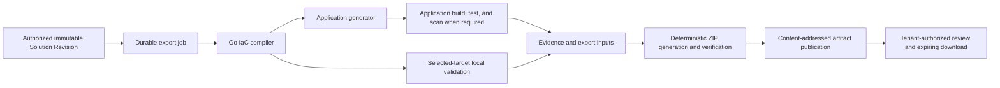

# Immutable Solution Revision export workflow

> Public distribution note: links to internal historical plans and operational
> records are omitted here; the retained text describes the original decision or
> design.

## Purpose

Prompt 33 composes the existing deterministic compiler, application generator,
isolated verification runners, export packager, Async Job lifecycle, object
store, API, and web review surface. It creates downloadable reviewed code; it
does not plan, apply, deploy, mutate a repository, or access a customer cloud
account.

The durable decision is
[ADR-0031](../adr/0031-immutable-solution-export-orchestration.md). The
implementation plan is M7 immutable Solution Revision export workflow.

## Authority and inputs

The browser may select only:

- one immutable Solution Revision ID already visible in the authorized project;
- one project environment selector;
- one approved export/target profile ID; and
- one bounded export display name.

Those selectors do not establish ownership, identity, coverage, entitlement,
target settings, or hashes. The API re-establishes all of them from the verified
principal and canonical repositories. Before a job is queued it resolves:

- organization and project ownership;
- the exact Solution Revision manifest record, object version, and SHA-256;
- architecture, Workload, Application Contract, and external-resource bindings;
- exact generation coverage and unresolved behavior;
- the approved target/profile snapshot and digest;
- the previous successful export selected as the fixed diff baseline;
- export and complete-generation entitlements, evaluated without mutation.

Pure entitlement evaluation happens before the durable job claim. A future quota
or credit reservation may occur only inside the idempotent claim/enqueue
boundary; the current local composition does not claim a commercial reservation.

The raw idempotency key, tenant claims, storage locations, credentials, and
signed URLs never enter the job input. The content-addressed settings/input
object and exact manifest subject are immutable for every claimed run and every
internal execution of that run.

## Workflow

Each stage receives only the bounded data its existing contract requires.
Application verification can be skipped only for a mode whose canonical contract
says no generated application build is required. Terraform validation uses the
compiler's exact checksum-bound `infrastructure/*.tf` files. CloudFormation uses
the compiler's exact checksum-bound JSON template and the built-in
credentialless structural validator; it never invokes the Terraform runner.
Neither path changes compiler semantics or infers IAM from source. The singular
compatibility form admits one generated application build contract. The
canonical bounded batch form defined by ADR-0037 must cover every eligible
generated workload exactly once, orders entries by workload/build-contract
identity, and invokes the same Prompt 32A runner once per workload. Missing,
extra, duplicate, mismatched, colliding, failed, or noncanonical entries block
the aggregate build stage and publication; no partial export is downloadable.

The orchestrator reports bounded progress through the Async Job context, checks
durable cancellation between stages and after staged output persistence, and
records digest-bound checkpoints plus durable report references where they
exist. The injected local worker mirrors progress into the public job on a
best-effort basis; a failed progress write is ignored because checkpoints and
the terminal read model remain authoritative. Version 1 internal retries restart
from the exact immutable job input; checkpoints are audit and reconciliation
records rather than stage-resume authority. Content-addressed, idempotent
adapters prevent duplicate publication, while the fixed revision, target
profile, previous-export baseline, and entitlement decision cannot switch.

## Stage truth and failure

The tenant-scoped export read model is separate from the generic success-only
job output so that completed stage diagnostics and evidence remain visible when
a later stage fails.

| Condition                                                                      | Job/review behavior                                                                               | Download disposition                                    |
| ------------------------------------------------------------------------------ | ------------------------------------------------------------------------------------------------- | ------------------------------------------------------- |
| Infrastructure-only compilation and validation pass                            | Succeeds; exact coverage remains infrastructure-only and `application-code-required` is prominent | Verified ZIP allowed                                    |
| Generated starter or complete pattern passes every required stage              | Succeeds with source, tests, evidence, Lambda checksum, manifest, and ZIP checksum                | Verified ZIP allowed                                    |
| User-provided or external artifact is reference-only and meets its contract    | Succeeds without executing unknown code; reference and readiness remain explicit                  | Verified ZIP allowed                                    |
| Compiler, generator, build, test, scan, or selected-target validation blocks   | Terminal failure remains visible with sanitized diagnostics and valid stage evidence              | Blocked; no combined ZIP                                |
| Export assembly, manifest verification, or path/content security fails         | Terminal failure; no artifact is published                                                        | Blocked                                                 |
| Permanent publication-integrity verification fails                             | Visible publication-stage failure; no artifact is published                                       | Blocked                                                 |
| Terminal job persistence fails transiently                                     | Job remains queued and artifact stays hidden for retry                                            | Blocked while queued                                    |
| Cancellation wins after staged persistence or at worker/result-store precommit | Canceled; staged bytes stay hidden and completed stage summaries remain visible                   | Blocked                                                 |
| Artifact or grant expires                                                      | Artifact metadata remains reviewable under retention policy                                       | Blocked until an eligible artifact receives a new grant |

`generationCoverage` is the assessment bound to the immutable Solution Revision
and is never rewritten by workflow execution. Required build/test/scan truth is
a separate canonical `applicationVerifications` collection, with the singular
`applicationVerification` compatibility projection retained for one-workload
results. Each entry records the exact build request, workload, generated
artifact manifest, Evidence, and either the confirmed state or a downgrade
reason. Passing every required build may confirm the frozen assessment; any
non-passing build can downgrade readiness but can never change or upgrade
immutable Solution Revision coverage.

Sanitized diagnostics preserve only stable code/severity/stage and optional safe
provenance: a repository-relative path plus node, edge, workload, or
owned-policy identifiers. Raw tool messages, stdout, stderr, and local paths are
not public. Compiler diagnostics remain diagnostic findings. The Terraform
validation boundary separately emits and persists one
`infrastructure-compilation` Evidence record that binds the exact compiler
artifact and approved compiler pin, and one `terraform-validation` Evidence
record that binds static checks/scanners and the exact validation report. Their
distinct semantic kinds remain distinct in the public review model.

For CloudFormation, the same compilation truth is paired with exactly one
`cloudformation-validation` Evidence record binding the canonical JSON,
compiler-declared local-validator identity, settings, revision, artifact, and
report digest. Target-specific evidence cannot satisfy the other target. Exact
catalog `0.15.0` applies this path to curated networking and event-driven
CloudFormation. Validation receives the same final multi-workload Prompt 45A
artifact batch and cannot regenerate, upload, or substitute it. Target
limitations are compiler diagnostics before packaging; a local validation report
cannot convert an unsupported graph into an export.

The fixed portable pull-request workflow verifies either target's sealed package
without credentials. The existing reviewed plan/deploy/drift/smoke workflow set
is Terraform-specific and is not authorized for CloudFormation; no change-set or
stack execution stage is introduced.

## Persistence and retry

The generic Async Job execution record remains authoritative for queue state,
lease/attempt context, internal retry, cancellation, entitlement/reservation
linkage, and audit when its persistent adapter is composed. The public Prompt 33
model does not invent attempt history; it exposes the durable run state and
explicit run lineage. An additive export read model stores:

- exact job, organization, project, actor, Solution Revision, manifest record,
  and target-profile commitments;
- fixed previous-artifact baseline and deterministic rerun lineage;
- current stage plus sanitized diagnostics, warnings, coverage, and evidence
  object references;
- immutable artifact, manifest, file, ownership, provenance, checksum, and diff
  metadata; and
- short-lived principal-bound download grants, recording only token digests if
  bearer tokens are used.

Large documents, stage results, previews, evidence, manifests, and ZIPs remain
in versioned content-addressed object storage. Publication uses the existing
staged-object-first protocol. Cross-store partial failure stays hidden and is
recoverable; readers expose only published objects whose stored digest and
tenant lineage match metadata.

Before packaging, the workflow constructs a strict `externalStageStatus` from
the selected environment, target-settings and workflow-request digests, passing
application-build and selected-target validation reports, and their full
canonical Evidence digests. The manifest labels those completed stages
`passed-before-export`. The pure exporter retains its own truthful
`not-run-by-export` and `not-collected-by-export` placeholders because it does
not execute either runner or manufacture their Evidence.

Authorization and pure entitlement evaluation precede the idempotent job claim;
the claim's conflict digest covers the exact primary request selectors but not
the server-selected previous-export baseline. The first claim stores the exact
workflow submission and fixed baseline. Replaying the same key and primary input
always returns that original job and calls idempotent `ensureEnqueued` if it is
still queued; reusing the key for different primary input fails. A different key
with identical primary input reuses the existing job while it is active, or
after success while its exact artifact remains retained and available. A
different key after failure, cancellation, or artifact expiry creates a
successor whose required `runSequence` increments and whose `rerunOfJobId`
points to the preceding run. That successor receives its own fixed baseline.
Stable regenerated bytes may retain the same content digest. Job/run IDs,
internal attempt IDs, timestamps, and progress never enter deterministic ZIP
bytes.

## Durable prepared-producer foundation (M9, 2026-09-06)

The frozen offline slice supplies an internal Terraform-only producer, not an
activated end-to-end implementation of the workflow described above. Its
`PostgresSolutionExportRevisionRepository` reuses the existing canonical
`getSolutionRevision` reader and verifies the exact published architecture and
manifest objects, immutable bindings, and coverage. Derived workload and job
objects use identities bound to purpose, organization, project, and content
digest; identical bytes in different tenants cannot collide in globally keyed
object metadata. The shared revision reader accepts PostgreSQL `BIGINT` decimal
strings only through strict safe-integer conversion, preserving positive versus
nonnegative constraints. This is driver compatibility, not relaxed domain or
Data API validation.

`DurableSolutionExportProducer` publishes the exact immutable workload, workflow
request, and orchestration inputs, then admits a genuine root through
`JobService` and `PostgresAsyncJobRepository`. It requires real object, queue,
audit, and entitlement ports; it neither manufactures root rows nor substitutes
a no-op queue. Every request-bound SQL boundary rechecks current canonical
principal, organization, project, and permission authority, including after
object I/O.

The public `requestIntentDigest` remains distinct from the root's canonical
Async Job create-request digest. A purpose-separated internal admission key
binds the principal, organization, project, and public key digest without
persisting the caller's raw key. The root derives its own key, request, and
input digests through the existing contracts. Exact replay retains the original
root and admission timestamps; changed input cannot reuse its claim. This slice
does not implement the public different-key coalescing, successor selection, or
previous-artifact policy described above.

A genuine root may be durably queued before its prepared export run exists, but
it is not dispatchable until the exact published inputs, fully read source
references, and prepared SQL run are committed and verified. Mandatory export
readiness gates initial publication, same-key dispatch recovery, queued and
stale-claim reconciliation, lifecycle requeue, worker retries, and orphan
recovery. Missing or failed readiness never publishes an export envelope;
non-export job behavior is unchanged. After awaited readiness, the publisher
rereads the current queued record, version, cancellation, and expiry before
sending. SQL and an external queue do not share an atomic commit: cancellation
can still race after that check, so the worker's current-state and execution
fences remain final authority.

Production producer composition and public create/cancel wiring remain absent.
The independent retained-read composition below does not activate terminal
compiler/build/validation workers, artifact or ZIP completion, GitHub delivery,
or any provider. This producer foundation does not extend historical `0012`
storage to CloudFormation. Focused crash/replay, concurrency, immutable-source,
tenant-denial, and real-PostgreSQL evidence is recorded in the service
continuation.

## Review API and web behavior

The M9 production read facade now wires the six existing job, artifact, file
preview, diff, download-grant and download operations independently of export
admission. It resolves the organization from the verified actor, uses the real
PostgreSQL run/download repositories and object store, and rechecks current
principal, membership, project and publication authority after awaited work.
Link and content responses also fence the verified retention/grant deadlines
after the final authorization wait. This is not export creation or proof that a
hosted worker has produced an artifact; create and cancel remain unavailable.

API readers import the declared
`@cloudmarkup/solution-export-workflow/contracts` entry point. It preserves the
existing workflow schemas and profile-digest function while excluding the
worker-only native diagram adapter. The existing root exports remain compatible
for workers. The production Lambda bundle test requires these contracts and
continues to reject the renderer and native `.node` dependencies; no native
loader or broad externalization is added.

The additive Solution export API exposes authorized create, status, cancel,
artifact review, bounded text preview, previous-export diff, download-grant, and
grant-consumption operations. Legacy endpoints that export an already existing
artifact remain compatible and do not acquire Prompt 33 semantics.

The review projection includes:

- exact Solution Revision and target/profile summary;
- best-effort server progress, cancellation, exact terminal status,
  `runSequence`, and `rerunOfJobId` when versioned;
- the immutable revision `generationCoverage` and distinct canonical
  per-workload `applicationVerifications` plus the singular compatibility
  confirmation or downgrade;
- exact solution/workload missing requirements, unresolved requirement IDs,
  coverage Evidence requirement/ID bindings, and application-build Evidence
  linkage;
- architecture, Workload, and Application Contract source entries;
- generated IaC, application source, tests, built artifacts, and checksums;
- separately typed compilation/static-validation/build Evidence plus sanitized
  diagnostics with safe path/node/edge/workload/owned-policy provenance;
- warnings, readiness, extension points, unresolved behavior, and ownership by
  path;
- deterministic semantic and file diff against the fixed previous artifact;
- manifest metadata and artifact references; and
- server-authoritative download disposition and grant expiry.

Text preview is allowed only for a bounded allow-list of UTF-8 media types and
returns a separately validated safe body. Binary entries expose metadata and
checksums, not inline bytes. Route IDs, file IDs, job IDs, artifact IDs, and
grant IDs are untrusted selectors. Every lookup repeats organization/project,
principal, lineage, publication, and expiry predicates. Cross-tenant guesses are
indistinguishable from missing resources.

Guided and Professional modes render the same component hierarchy, stages, tabs,
files, evidence, controls, disabled reasons, and actions. Only a reserved help
paragraph may use different explanatory wording. Prompt 33A diagrams and Prompt
33B CLI/GitHub actions are absent rather than represented as completed.

## Download response

A grant is created only for a published, independently verified ZIP with
download disposition `verified`. It binds the current principal, organization,
project, artifact, object version, digest, and expiration. Consumption
reauthorizes those bindings and returns, at minimum:

- `Content-Type: application/zip`;
- a sanitized attachment filename in `Content-Disposition`;
- `Cache-Control: private, no-store`;
- `X-Content-Type-Options: nosniff`; and
- an explicit byte length and checksum metadata.

The public body and logs exclude the object key, local path, upstream URL,
credential, token digest, raw prompt, secret, and internal runner output.

The current production REST-v1/Lambda adapter is buffered, so its read facade
enforces a 4 MiB raw ZIP ceiling before grant insertion and download. This
leaves room for base64 and the bounded response envelope within the 6 MiB Lambda
limit. Larger verified archives retain valid metadata and bounded file review
but return an explicit streaming-unavailable error; creating another grant
cannot resolve it. The 64 MiB export contract is unchanged, and support for
downloading its full range requires a separately integrated streaming transport.
No upstream storage URL is exposed as a fallback.

The existing error envelope marks that permanent host limit with namespaced
field issue `solution-export.download-streaming-required.v1` at
`artifact.download`. The UI does not infer it from arbitrary message text: only
that exact reason suppresses grant/content retries for the current principal,
organization, project, artifact and digest. Other unavailable-service or network
failures remain retryable. Read-only job review also hides Cancel unless the
current capabilities include `exports.run`.

## Delivered worker lease recovery

The callable production export consumer now distinguishes a live running attempt
from an expired lease. For an unexpired job with current creator permission and
remaining retry capacity, it applies the existing domain `reconcile-orphan`
command. A separate recovery authority binds the exact tenant, project,
immutable input and last attempt; database time establishes expiry. Root
version, orphaned attempt and audit commit atomically.

The original FIFO delivery remains pending until the retry is due. Its next
claim derives a new envelope from the current immutable snapshot, and the three
retry-admission checks accept only a failed or orphaned attempt with a reviewed
retry disposition. Concurrent recovery produces one transition. The previous
worker cannot execute, publish artifacts or advance the replacement.

This path does not settle terminal expiry, exhausted retries, cancellation or
deleted-project work. Those need an exact terminal/financial recovery receipt;
they remain pending and the permanent project write fence stays closed. The
ordinary worker host and released isolated executors remain separate unfinished
composition.

## Verification

Unit and integration tests use deterministic in-memory repositories and the
callable local composition. That composition injects the compiler plus concrete
application-generator, application-build-runner, Terraform-validation-runner,
CloudFormation local-validator, and export adapters. The orchestrator selects
exactly one infrastructure validator from the immutable target setting;
established process-capable runner interfaces use fake bounded executors in
tests instead of invoking unapproved host tools. These tests exercise immutable
input validation, state-aware primary-input reuse/versioning, retry-safe
enqueue, post-persist and precommit cancellation, transient persistence retry,
permanent publication-integrity failure, stage failures, reproducible reruns,
previous-export diff, artifact integrity, grant expiry/revocation, and denied
cross-tenant access.

Web component tests and the Playwright suite separately exercise the same
semantic UI in both assistance modes. Playwright intercepts the Prompt 33 API
surface with schema-shaped fixtures; it verifies browser request/render/download
behavior and leakage protections, not a hosted API, worker, database, object
store, or real runner execution.

The exported injected local composition is callable and exercised directly by
integration tests without AWS. It is not wired into the ordinary local API
server. Create and cancel remain fail-closed unless a
`SolutionExportApplication` is injected. The M9 production reader supplies real
SQL/object-store reads separately; its tests include isolated PostgreSQL and the
actual Hono REST-v1 base64 response envelope, not hosted export execution.

No ordinary test requires AWS credentials, Terraform deployment, customer
access, a package registry, or a deployed CodeBuild project.
