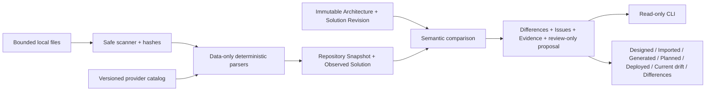

# Local repository import and conformance

> Public distribution note: links to internal historical plans and operational
> records are omitted here; the retained text describes the original decision or
> design.

## Scope

Prompt 33C adds a local, deterministic, no-credential observation boundary. It
imports an explicit directory before AI use and compares repository truth with
the exact approved Architecture v3 document and Solution Revision manifest. The
approved design remains authoritative. Import never executes repository content,
silently changes design, or claims to observe deployed cloud state.

## Boundary

`@cloudmarkup/repository-importer` receives:

- one absolute local source directory;
- a strict importer profile with immutable time, commit, source descriptor,
  selected subtrees, and limits;
- the approved Architecture Document and Solution Revision; and
- one exact provider catalog artifact.

It returns a canonical Repository Snapshot, Observed Solution, imported facts,
semantic differences, safe diagnostics, Active Issues, level-8
repository-conformance Evidence, and an optional review-only Reconciliation
Proposal. Every fact contains parser identity/version, confirmed or unresolved
confidence, target/provider, ownership, source range, source Evidence, and a
complete digest.



## Supported sources

- canonical `cloudmarkup/` architecture, workload, contract, external-resource,
  lock, solution, and manifest JSON; historical product-name aliases are
  rejected;
- Terraform `.tf`, `.tf.json`, and sanitized Terraform show plan/state JSON;
- CloudFormation JSON/YAML and `cdk.out/*.template.json` synthesized output;
- generated application/source and environment-binding manifests plus bounded
  supported application configuration/source inventory;
- `.github/workflows/*.yml|yaml` structure relevant to generation, verification,
  planning, deployment, and drift.

The scanner ignores `.git`, `.terraform`, dependencies, caches, coverage,
build/dist/temp directories, and local environment files. Selection is an
explicit subtree allowlist. All encountered paths are portable and all included
files are regular, non-link, bounded UTF-8 text. NFC/case-fold collisions,
Windows device/ADS syntax, traversal, absolute or backslash paths, binary data,
and configured file/count/total limits fail closed.

## Terraform and sensitive input

Terraform HCL crosses the fixed `cloudmarkup-iac inspect-terraform-hcl` protocol
described by
[ADR-0033](../adr/0033-deterministic-repository-import-parser-boundary.md). Only
ranges, expression categories, digests, and safe references return. The importer
never receives HCL literal values. Terraform show JSON and template properties
are recursively reduced; secret-like keys are replaced before any fact,
diagnostic, UI, CLI, Evidence, or ordinary artifact is constructed. Raw
state/plan bodies are neither returned nor persisted.

## Comparison semantics

The version-1 difference vocabulary is:

- match;
- designed but not observed;
- observed but not designed;
- configuration or connection mismatch;
- IAM expansion or reduction;
- ownership mismatch;
- generated-file drift; and
- unsupported or unresolved import.

Exact Cloud Markup node/edge identity compares stable resource, provider,
deployment, configuration, relationship, endpoint, and relationship-config
semantics. Presentation labels do not participate. Terraform,
CloudFormation/CDK, application, and workflow mappings report exact observed
facts but do not claim an approved match without a stable exact design binding.
External data/import references become External Resource candidates with only
available identifiers and unresolved ownership fields.

Generated-file checksum and ownership differences are read-only findings. The
importer never regenerates or overwrites source. Wildcard allow policies are IAM
expansion; explicit denies are IAM reduction. Mutable GitHub action references
are unresolved and require review.

## Reconciliation and UI

The CLI adds `import`, `inspect-repository`, `compare`, and `verify-repository`;
`--source` is the explicit-directory alias for `--root`. All four commands use
the locked repository source, are non-mutating, support canonical JSON/stable
human output, and retain the established stable exit codes. A missing approved
importer registration fails closed.

The editor Code workspace uses the same continuous-conformance component for
Designed, Imported/observed, Generated, Planned, Deployed, Current drift, and
Differences. Repository import supplies only the Imported projection; it cannot
fill or promote the other layers. Guided and Professional modes differ only in
explanation. Imported resources retain explicit confidence, ownership, external
status, and source provenance. Controls emit bounded review intent for a known
finding or reconciliation proposal. They do not mutate the architecture or
silently overwrite repository files.

Only exact imported Cloud Markup graph elements can carry Graph Command batches,
and the importer validates their predicted result with the existing domain
engine. Other actions remain typed review operations for an authorized caller.

## Hosted GitHub acquisition

Prompt 40B reuses this importer without adding network or credential authority
to it. The GitHub App boundary resolves one exact commit, applies a stricter
remote path/type/count/byte policy, redacts selected application excerpts, and
materializes only accepted bytes in a private temporary directory. The importer
still receives an ordinary explicit directory and remains deterministic.

A Repository Snapshot record binds organization, project, installation,
repository, branch context, commit, selected/ignored paths, safe file digests,
Prompt 33C output, and any previous snapshot. Refresh creates a new record. A
moved branch, stale review digest, revoked installation, rate limit, truncated
tree, link/submodule, sensitive file, or ambiguous portable path cannot weaken
the exact-commit boundary.

The editor uses the approved architecture projection for all comparison views;
repository evidence changes annotations only. Hosted review adds an explicit
reject action and requires exact server operations for accept, keep observed,
mark external, regenerate, and ignore-with-reason. Ambiguity is an Active Issue,
not a client-side resolve mutation. Accepted design changes use canonical
operations; regeneration only prepares the existing reviewed branch/PR export.

See
[GitHub App repository import setup](../development/GITHUB_APP_REPOSITORY_IMPORT.md)
for permissions, limits, endpoints, and fake-backed verification.

## Saved-draft acceptance in the current local beta

The production import facade now accepts an exact stored
`accept-observed-graph-change` proposal through the repository-backed
`applyDraftCommand` boundary. Review supplies the saved draft ETag and current
editing-lease proof; the server supplies the stored commands and expected and
resulting semantic content hashes. A changed baseline or different result fails
before staging. The optional bindings preserve older request shapes.

The editor drains autosave before acceptance, holds the exact request identity
through uncertain responses and reloads the saved result only for the same
active project, editing lease and local change generation. Navigation, lease
loss or new local edits cannot replace a different editor's document. Explicit
reload remains available after an uncertain result.

Migration 0035 retains immutable command-receipt metadata keyed by organization,
project, principal and hashed idempotency key. The request digest excludes
ephemeral lease credentials, which are reauthorized on every call. Receipt
insertion shares the pending-draft transaction; normal object publication and
recovery follow. Exact retry returns the originally accepted version after later
saves or process reconstruction, rather than reapplying the command.

The selected `stripe-sandbox-github-connections-v1` beta profile now packages
the fixed Go parser as a checksum-bound Linux ARM64 Lambda layer. Release
admission verifies the actual binary, architecture, size, API-only attachment
and environment pins. Other beta profiles omit it. This is locally verified
composition, not evidence of a deployed import.

Ordinary Terraform/CloudFormation observations without an exact reviewed domain
operation remain observational. Mark-external, regeneration and automatic
refresh are still uncomposed in the current production facade.

## Evidence meaning and exclusions

A passing check means selected repository files were safely imported and the
reported repository-conformance conditions passed. It does not prove a Terraform
plan, deployed architecture, runtime behavior, cloud drift, or customer-account
state. Import uses no AI, network, credentials, AWS SDK, Terraform, CDK
application, package manager, shell, repository script, deployment, upload, or
design mutation.

## Development commands

```powershell
pnpm check:repository-importer
pnpm check:architecture-cli
go -C services/iac-compiler test ./... -count=1
pnpm check:web
pnpm check:contracts
pnpm security:check
```

## Unsupported-source correction in importer 1.0.2

A module-only Terraform source or transform-only CloudFormation template can
contain deployment meaning without any directly observable resource. Importer
1.0.2 records these declarations using actual file/range evidence and fixed
summaries; module source URLs, parameters and literals are not echoed. Root
Terraform HCL/JSON modules, top-level CloudFormation transforms and nested
`Fn::Transform` calls in recognized templates make the observation incomplete.
Known literal facts remain available for review. No expanded resource, service
relationship or Graph Command is fabricated.

These findings use the existing `unsupported-unresolved-import` difference and
Active Issue contracts with error severity because complete conformance cannot
be established. The repository check fails, `verifyRepositoryImport` returns
false, and the conformance layer remains partial. A completed file acquisition
is still a retained review snapshot, not proof that all infrastructure was
understood. Review module sources separately or supply a processed template;
this parser never downloads modules or executes transforms.

The correction is isolated from the CloudFormation runtime candidate. Existing
1.0.1 records and the frozen AI dataset remain unchanged. Explicit historical
snapshot-digest reads do not select historical parser behavior for new imports.
The current production request now requires importer 1.0.2, with the reviewed
2.9.0 repository assessor and durable parser-input receipt validation. The
historical 2.6.0 assessor retains its 1.0.1 lineage and cannot silently accept
current parser output. See the
[production request](../../apps/api/src/production-model-live-repository-request.ts),
[successor assessor](../../apps/api/src/model-live-repository-case-assessment-v2-9.ts)
and original execution plan. This records implemented provenance admission, not
permission for a live model invocation or proof that arbitrary source has been
understood.

## Connected GitHub file discovery

The local M9 discovery successor adds a version-1 read-only POST at
`/v1/projects/:projectId/github-repository-discovery`. It binds a verified
project, installation, repository, branch context and exact commit, then reads
only the recursive Git tree. Current project and integration authority is
checked around provider reads and before metadata is returned. Discovery needs
no saved solution revision; actual import retains that requirement.

The result contains eligible relative paths, exact Git blob identifiers, known
byte counts, commit/tree identity and whether the branch has moved. It contains
no file contents, import reservation, model inference or graph mutation.
Existing limits remain 20,000 tree entries, 4,096 selected files, 8 MiB per file
and 128 MiB in total. Missing file sizes, truncated or substituted trees,
duplicate/colliding paths, links, submodules and inconsistent file modes fail
closed. Sensitive and ignored paths are omitted. Actual import still verifies
downloaded blob bytes.

The picker supports search, 50-file pages and up to 128 explicit selected paths,
with the existing manual folder scope and whole-repository option. Changing the
source invalidates its discovery; late replies cannot populate another commit. A
file list is selection metadata, not evidence that a resource or source-to-
workload relationship is understood. Uploaded files, GitLab acquisition and
additional reviewed workload mapping remain separate unfinished checkpoints.
This source is locally verified and remains unpublished and undeployed.

### Remaining uploaded-source and workload mapping prerequisites

The current importer profile, Repository Snapshot and Observed Solution all
require a Git commit identity. A browser upload must not fabricate a commit SHA
from file bytes or reuse an unrelated repository commit. Add a reviewed,
versioned non-Git source-origin contract with a canonical manifest digest,
per-file digests and immutable tenant/project ownership before exposing upload
as a supported source. Preserve historical repository snapshots and their
existing digest calculation and receipt admission.

Upload acquisition must enforce authenticated ownership, bounded file counts and
bytes, safe relative paths, duplicate/case-collision checks, UTF-8/content
checks and explicit sensitive-file exclusions before parsing. The trusted host
must own any staging directory; user file names cannot select an absolute path,
link, executable or parser arguments. Quota, expiration, cancellation, cleanup
and revocation after acquisition need production tests. Archive decompression is
a separate boundary and must not be implied by ordinary file selection.

Current confirmed workload bindings come from explicit CloudMarkup documents and
application manifests. Arbitrary application files need separate, source-bound
observations: resolve Lambda handler/artifact paths within the selected source
set, identify supported runtime entry points and keep ambiguous or missing
bindings unresolved. AI can propose a typed association with exact source
evidence and questions; only reviewed domain commands may turn it into a canvas
or workload change. Selecting a file in the new picker supplies no additional
inference, execution or mutation authority.
