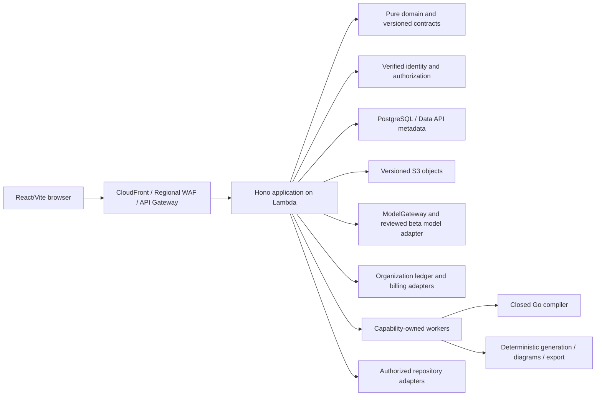

# System overview

> Public distribution note: links to internal historical plans and operational
> records are omitted here; the retained text describes the original decision or
> design.

Cloud Markup is a React/Vite application, a TypeScript modular-monolith API,
provider and platform adapters, and a standalone Go IaC compiler. This page maps
implemented responsibilities and durable boundaries.
[STATUS](../PUBLIC_STATUS.md) owns current activation, exact releases and
unresolved M9 holds; a package's existence does not mean every adapter is
enabled in the beta.

The [ADR index](../adr/README.md), [domain model](DOMAIN_MODEL.md) and
[solution/repository/evidence contracts](SOLUTION_REPOSITORY_AND_EVIDENCE.md)
define the accepted semantics. Historical foundation descriptions are
retrievable through HISTORY.

## Dependency and trust boundaries

Arrows describe requests or dependencies, not a promise that each box is a
separate deployed service. The core depends on pure schemas and contracts;
application services coordinate authorization, transactions and ports; adapters
provide storage, identity, provider and delivery mechanics. Domain code imports
no React, AWS SDK, database/network client or IaC renderer. Cross-package
imports use declared exports. Splitting a capability into a service requires
evidence and a separate durable decision.

The typed, versioned graph is authoritative for architecture meaning. Workload
Behavior, Application Contracts and External Resource References retain their
own versioned semantics inside the Architecture Document. A Solution Revision
pins the exact source documents, repository observations, catalog and tool
identities. Model output and observations cannot bypass this authority.

## Web application and editing

`apps/web` owns project navigation, the editor, proposal review, issues,
preferences, revisions and export presentation. React Flow projects the parsed
document; per-editor Zustand state contains transient interaction state. React
Hook Form owns inspector form buffers. Neither library owns graph truth.

Service creation, configuration, connection resolution, movement, deletion and
safe fixes use Graph Command v1. Batches are atomic, preconditions fail closed,
and generated/adopted/shared resources retain explicit lifecycle rules. The
reviewed deletion preview cannot overwrite a changed draft. Undo and redo replay
domain-approved inverses; selection, viewport, panels, form buffers and previews
remain outside semantic history. The existing history limits remain 100
operations and 2 MiB, with a validated in-memory checkpoint.

The exact catalog supplies service configuration, ports, containment,
relationships, validation and presentation. A provider-neutral resolver prepares
complete typed connection effects; the UI never reconstructs those effects.
Service-owned configuration and policy nodes remain semantic graph facts, even
when projected through the owning service instead of a separate canvas card.

Boundary hierarchy uses parent-relative coordinates and shared placement
validation. Local ELK layout receives stable IDs, hierarchy, dimensions, typed
ports and edges, without configuration values or credentials. Untrusted results
must preserve identities, parents and complete finite geometry before a
position-only command preview. Cancellation discards late results.

Overview tiles, wrapped boundary headings and aggregate connection docks improve
readability across zoom. Multiple displayed edges may share a dock while keeping
their exact semantic ports. Popovers, collapse, fan-out rank and viewport
changes do not alter either architecture hash or IaC addresses. The inspector,
lower expansion controls and proposal spacing retain keyboard/pointer access.

Validation is bound to document/catalog/engine/environment/target hashes. Late
or mismatched results fail closed. Safe fixes are replayed, completely previewed
and confirmed against the current document. Grouping findings or reviewing
warnings in the UI does not invent a production acceptance policy or prove
higher-level conformance. Unknown regional availability remains unknown.

Browser recovery uses bounded, strict, hash-bound IndexedDB envelopes,
compare-and-swap generations and bounded cross-tab notices. Explicit recovery
re-inspects a damaged record before replacement/deletion. It excludes
credentials and provides no tenant authority, backend acknowledgement or export
eligibility. Hosted drafts and editing leases provide the separate authorized
server lifecycle; local recovery does not replace them or imply simultaneous
collaborative editing.

Guided and Professional modes share controls, geometry, commands, documents,
validation, revisions, entitlements and exports. Only wording, education and
optional technical disclosure vary. Responsive review and accessible controls
remain first-class requirements. See [UI specification](../design/UI_SPEC.md),
[accessibility](../design/ACCESSIBILITY.md) and
[assistance modes](../design/GUIDED_AND_PROFESSIONAL_MODES.md).

## API, identity and persistence

`apps/api` owns Hono routes, application services, ports and composition.
Logical modules cover principals/organizations, projects/drafts, revisions,
artifacts, repository observations/reconciliation, validation, proposals, jobs,
billing, exports and audit. Canonical runtime schemas drive HTTP contracts and
OpenAPI; the typed browser client remains transport-injected.

Cognito access-token verification checks signature, issuer, expiry, token use,
app client and scope. The application maps the verified subject to an active
principal, re-reads membership, derives canonical permissions and checks exact
resource ownership. Client tenant/actor IDs are selectors, never evidence. The
local identity adapter cannot activate in production. Strong ETags,
principal-scoped idempotency and recent-auth checks protect consequential
changes. See [authorization](AUTHORIZATION_MODEL.md).

PostgreSQL repositories repeat tenant/member/resource predicates above either
the local node-postgres executor or RDS Data API. Driver details do not enter
the domain. SQL projections require unique column labels so Data API decoding
cannot hide duplicate-field bugs. Editing leases and permanent deletion fences
remain server-enforced, including when older clients retry.

S3 stores large documents and artifacts; filesystem and memory adapters support
local tests. Metadata binds exact object version, digest, byte count, content
type, purpose and authorized ownership. A key alone grants no access. Identical
content can be shared only inside the authorized organization/project boundary.

Database/object publication is deliberately staged: write a conditional object,
commit hidden pending metadata, publish the exact object version, then expose
the database reference. Recovery is idempotent; a failure cannot expose
incomplete revisions or silently discard the last published draft.
Solution/repository/AI records use the same exact-object and publication rules.
Later Evidence never rewrites a freeze-time revision manifest.

Ordered migrations are checksum-pinned, forward-only and independent from
proposed AI migrations. See STATUS for the current manifest, migration count and
independently verified applied version. Do not infer the applied set from its
maximum version alone. Immutable revisions, audit records and the append-only
ledger retain database-level protection.

Requested project erasure coordinates the permanent write fence, pending writes,
jobs, financial holds and version-aware S3 deletion. Its hosted worker is
enabled; old cleanup-disabled prose is historical. Backups expire under approved
retention, and retained audit/billing metadata, external customer copies and
account-wide erasure have separate boundaries. See
[data classification/retention](DATA_CLASSIFICATION_RETENTION_AND_DELETION.md)
and [ADR-0046](../adr/0046-project-content-erasure.md).

## Models and commercial accounting

The provider-neutral `ModelGateway` defines strict operation contracts, trusted
routing and pricing provenance, necessary-context minimization, exact scope,
bounded attempts/timeouts and schema-only response tools. Browser content cannot
select authority, prices, retries, routes or entitlements. Model output is
untrusted and must pass schema, catalog, provenance, ownership and deterministic
validation before becoming a reviewable proposal. The gateway has no arbitrary
URL, shell, repository-write, compiler, payment or deployment authority.

The normal evaluation/promotion path remains fail-closed under its reviewed
configuration. The separate functional-beta infrastructure assistant has the
accepted bounded scope in
[ADR-0055](../adr/0055-functional-beta-infrastructure-assistant.md). The latest
release records Sonnet 4.6; requested GPT model access remains blocked. A
checked-in model entry is not proof of account access, quality or activation.
Local/CI verification uses deterministic fakes and incurs no live model charges.

Requirements and unaccepted proposals remain memory-only under the beta
boundary. Explicit application passes through the same Graph Command admission
and normal authorized draft saving as manual work. Current creation/review UI
shows estimates and job receipts. Optional application source is a
review-required draft governed by
[ADR-0057](../adr/0057-opt-in-beta-application-source-drafts.md); it is neither
executed nor certified as build-verified by export.

Each account is an organization with a billing account, versioned plan,
entitlements and pooled credits. Provider-neutral commercial contracts own
grants, reservations, pricing, compensation and suspension. Credits derive from
append-only events, not a mutable balance. Atomic reservations bind exact
grants, plan, policy and price before expensive work; terminal settlement,
release, expiry and compensation are idempotent and cannot erase provider-cost
evidence.

Members can read permitted summaries; owners/canonical administrators manage
billing, while trusted credit adjustments have a separate boundary. Verified,
idempotent Stripe webhooks update local subscription projections; redirects
never authorize a purchase. Beta billing/session UI is implemented and Stripe
remains in test mode. ADR-0063 is still Proposed despite delivered metering;
accepted historical economics are not silently rewritten. See
[billing and usage](BILLING_AND_USAGE.md), [model gateway](MODEL_GATEWAY.md) and
[commercial lifecycle](MODEL_COMMERCIAL_LIFECYCLE.md).

## Jobs and capability workers

The generic [async job framework](ASYNC_JOB_FRAMEWORK.md) owns exact-subject
identity, immutable creation plans, expected children, attempts, checkpoints,
versions, bounded retries, cancellation, awaiting-input receipts, recovery and
audit outbox rules. Generic in-memory/fake framework evidence must not be
confused with every capability's hosted implementation. There is no generic
client endpoint that grants arbitrary job execution.

Hosted workers belong to their API/application capability and are composed by
`infra/platform`, including beta model/export and project cleanup paths. Queue
identity, lease/fence checks, current authorization, durable terminal state and
idempotent publication remain explicit. Retries cannot select a newer revision
or silently settle a financial hold. The generic framework owns no independent
balance, pricing, compiler, provider or deployment authority.

## Providers, compilation and generated artifacts

`packages/provider-sdk` defines versioned provider contracts;
`packages/provider-aws` owns AWS service configuration, ports, deterministic
connection recipes, validation, education and mapping readiness. Exact compiled
catalogs and historical versions are digest-bound. AWS-first does not hardcode
the core. Modeling, configuration, validation, Terraform, CloudFormation and
generated-code readiness remain separate claims; unknown Region support is not
promoted by a UI selection. Assets have their own reviewed provenance and
integrity boundary. See the
[provider guide](../development/PROVIDER_CATALOG.md).

`services/iac-compiler` is a closed Go process consuming immutable,
version-bound requests. Normalization, Terraform and CloudFormation generation
are deterministic; unsupported mappings fail closed. Stable graph identity
preserves addresses. The compiler cannot use credentials, network/model clients,
arbitrary plugins, shell provisioners or deployment commands. See
[normalization](COMPILER_NORMALIZATION.md), [Terraform](TERRAFORM_GENERATION.md)
and [CloudFormation](CLOUDFORMATION_GENERATION.md).

Application generation has its own deterministic contracts and owned paths.
User-authored or AI candidate code cannot silently overwrite generated
ownership. Isolated build and Terraform validation adapters have pinned tools,
bounded resources and reviewed execution inputs; importing a source file does
not grant it execution authority. Synthetic test evidence is not live runner
activation. See [application source](APPLICATION_SOURCE_GENERATION.md),
[isolated builds](APPLICATION_BUILD_EXECUTION.md) and
[Terraform static validation](TERRAFORM_STATIC_VALIDATION.md).

The pure solution-export package assembles exact source projections, artifacts,
ownership/provenance manifests and deterministic ZIP bytes. The application
workflow separately authorizes an immutable revision, coordinates eligible
producers and publishes verified output. Diagrams use a pinned deterministic
renderer and exact reviewed icons. The Revisions UI defaults to infrastructure
and diagrams, with explicit source-draft opt-in. No export changes design,
executes a model draft, plans/applies customer infrastructure or claims a higher
Evidence level. See [packaging](SOLUTION_EXPORT_PACKAGING.md),
[export orchestration](IMMUTABLE_SOLUTION_EXPORT_WORKFLOW.md) and
[diagram rendering](ARCHITECTURE_DIAGRAM_EXPORT.md).

## Repository and continuous evidence

Repository import produces exact snapshots and Observed Solutions. Refresh
acquires a pinned GitHub revision through authorized adapters; it cannot replace
approved design silently. Reviewed reconciliation uses exact domain operations,
ownership, current preconditions and safe conflict handling. Unsupported
ordinary code stays observational. See
[repository import](LOCAL_REPOSITORY_IMPORT_AND_CONFORMANCE.md).

GitHub export uses an installation-scoped App boundary, exact repository and
branch authorization, reviewed file ownership and current permission checks
immediately before mutation. The generated customer workflow is a separate
artifact owned by the customer; it is not a platform permission to assume a
customer cloud role. CLI distribution/digest/installation and environment-policy
activation remain explicit holds. Persisted/digest-bound historical field names
retain compatibility. See [GitHub export](GITHUB_APP_REPOSITORY_EXPORT.md),
[architecture CLI](ARCHITECTURE_AS_CODE_CLI.md) and
[customer-owned CI/CD](CUSTOMER_OWNED_CI_CD.md).

GitLab.com is a separate, locally composed OAuth adapter with default-off
connection and export gates. Actor/session-bound link intents, KMS-encrypted
grants, exclusive refresh claims and selected numeric project versions constrain
its broader provider API scope. Tokens never enter graph data, browser storage
or AI input. Current application, project, session and commercial authorization
are rechecked around provider requests.

Reviewed GitLab export binds one retained immutable artifact, base commit, fresh
branch and exact files in a new destination directory. Durable dispatch claims
permit one commit and one draft merge request; uncertain outcomes recover by
reading provider state. Complete tree proof and bounded exact-file readback
precede the merge request. Review expiry prevents new writes. No export merges
or deploys customer infrastructure, and repository-owned automation is disclosed
before approval. OAuth/secret/key configuration and native-provider acceptance
remain activation prerequisites. See the proposed
[GitLab contract](../adr/0077-gitlab-oauth-and-reviewed-repository-export.md)
and current plan.

Continuous conformance compares designed, imported, generated, planned, deployed
and observed states with exact revision/environment/evidence identities and
freshness rules. Evidence may open issues or propose reconciliation but cannot
rewrite design, promote an unsupported verification level or trigger automatic
drift remediation. See [continuous conformance](CONTINUOUS_CONFORMANCE.md).

## Platform delivery and operations

`infra/platform` defines four capability/lifecycle stacks: Observability,
Stateful, Application and Edge. Credentialless local synthesis verifies their
one-way dependency order, exact resources and IAM/security boundaries. Platform
runtime packaging and its closed compiler are separate from customer IaC output.

The platform's deployed beta uses a reviewed GitHub OIDC delivery path. PR jobs
remain credentialless; operator/environment approval and immutable artifact
binding are separate from application authority. Main source/manifest pushes can
enter deployment, so merge and delivery must respect the owner-authorized
release scope. The refactor delivery is complete; its earlier temporary merge
hold is historical. No classifier expansion or approval bypass is an acceptable
workaround for a future release hold.

Typed non-secret deployment inputs include exact account/Region/environment,
domains, retention, identity, model and integration settings. Secrets remain in
approved external channels. Platform and customer infrastructure share no
deployment role, credentials or executable path. See
[platform deployment](AWS_PLATFORM_DEPLOYMENT.md) and operator documentation;
examples are not permission to execute them.

Traffic admission still requires alert ownership/delivery, approved retention
notices, RTO/RPO plus a restore drill and a tested private vulnerability intake.
Broader production SLOs, capacity, erasure and commercial/model activation need
their own evidence. Structured redacted telemetry must distinguish product
validation failures from platform failures; prompts and artifacts are not logs.
Every sensitive transition remains auditable, quota-bound and tenant-authorized.
